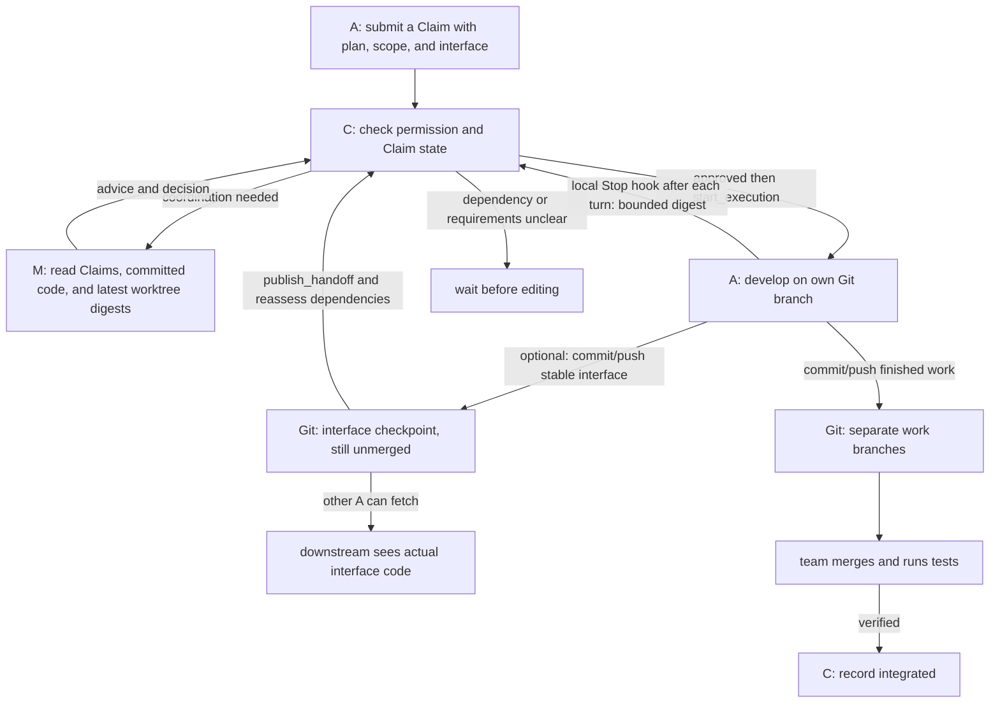

# TCA: coordinate developers before their code is merged

[中文说明](README_zh.md)

## The problem

One developer is changing an inventory module and may change its `reserve()` API. The work is still on that person's computer or branch; it has not been merged into the default branch. Another developer must build checkout from an old snapshot. They can guess an incompatible API, or wait for the entire upstream feature to merge.

TCA lets developers **disclose intent before editing shared code**. The upstream developer submits a Claim describing planned files, behavior, interfaces, and uncertainty. A coordinator uses those disclosures to assign responsibility and advise the downstream developer. When exact code is needed, the upstream developer can commit and push a small, stable **interface checkpoint** on their own branch without finishing or merging the whole feature.

**Limit:** TCA does not read uncommitted source on someone else's computer. A local hook automatically sends a timestamped **worktree digest** after each Codex turn: file additions/deletions within the Claim and Python function/method and signature changes. M can spot a changing interface but cannot reconstruct the implementation or infer its full behavior from the digest. The Claim conveys intent; the digest conveys metadata as of the last finished turn; a Git checkpoint makes actual interface code available.

## Roles and the harness

The **harness** is the set of rules around a normal coding agent such as Codex: when to submit a Claim, which state permits editing, what context the coordinator sees, and how to record handoffs and completion. Without it, agents often work from isolated Git snapshots and independently invent conflicting interfaces.

| Role | Responsibility |
| --- | --- |
| **A, developer** | Submit a Claim, then develop and push code on their own Git branch after authorization. One computer runs at most one code-committing A. |
| **M, coordinator** | Read Claims, committed code, and bounded digests of A's uncommitted work; clarify ownership, interface, dependencies, and acceptance conditions. M does not commit product code or receive uncommitted source. |
| **C, controller** | Maintain the authoritative state, check rules and permissions, apply M's decisions, and reject stale coordination results. C does not replace code review or Git integration. |
| **Project creator** | Start a project with repository admin permission, optionally delegate M, and verify final integration. |

This diagram shows where the harness acts. Every A submits their own Claim. M helps decide coordinated work; C can release independent work directly and may still give M a nonblocking observation task.



**Uncommitted source remains on its developer's computer.** Digests contain limited file, symbol, and API-shape metadata, not the complete code. The owner publishes a Git checkpoint when a downstream developer needs the actual interface; that developer still needs their own authorization to start.

A creator with write permission may run **one read-only M and one A in separate worktrees**. Each developer commits only with their own GitHub identity.

## Protocol and key states

1. A sends a **Claim** directly to the TCA MCP server: goal, planned paths and symbols, behavior contract, dependencies, Git base commit, and work branch. A Claim branch or webhook is unnecessary.
2. C checks declared boundaries. When coordination is needed, M leases a task, sends advice to the relevant A, and submits a decision. A calls `wait_for_decision` or `get_claim_state`. Shared edits require `allowed_actions` to contain `start_execution`, followed by an actual `start_execution` call.
3. A develops on their own branch and may report progress. `tca-codex` installs a local Codex `Stop` hook in A's worktree; the user must review and trust it in Codex. After each turn, the hook sends C bounded Git and Python API metadata, including file additions/deletions and signature changes. A does not run a watcher or receive an MCP snapshot tool. M receives the latest digest with a server timestamp and must treat missing or stale digests as unknown. Static metadata does not establish behavior semantics. When another A needs actual interface code, the owner commits and pushes a checkpoint, then calls `publish_handoff` with its SHA, exported symbols, and behavior contract. The owner can continue developing afterward.
4. A commits and pushes completed work. In hosted mode, `tca-client complete CLAIM_ID` checks the branch, base, clean worktree, remote head, changed paths, and declared top-level Python symbols. The Metadata-only GitHub App cannot independently read private diffs, so code and the reported evidence still need review. The team merges normally; the creator verifies integration.

| State | Meaning |
| --- | --- |
| `assessing` | Under review or renewed coordination; editing is not allowed. |
| `approved` / `approved_with_constraints` | Approved, optionally with explicit constraints; A must still call `start_execution`. |
| `waiting` | Waiting for a declared dependency or interface handoff. |
| `executing` | A is working and can report progress or publish a handoff. |
| `needs_human` / `blocked` | Human requirements clarification is needed / the current plan cannot proceed. |
| `expired` | Execution timed out without verified delivery; late Git evidence may be supplied. |
| `completed` / `integrated` | A reported delivery / the creator confirmed integration. **Completion does not mean merge.** |

### How conflicts are handled

- **Before coding:** M assigns ownership of shared files, functions, and data formats. One A can own the interface while another implements against it. A dependent task can wait for a small interface checkpoint instead of a full feature merge.
- **Staggered arrivals:** If A1 is executing, A2 has advice but has not started, and A3 joins the same group, C leaves A1 alone but reopens A2 and A3 for joint coordination. Earlier advice remains in history but is no longer current; decisions with old rounds or revisions are rejected. If A2 is already executing, M coordinates only the newcomer.
- **After delivery:** Developers still perform Git integration and run meaningful tests. TCA reduces blind conflicts; it does not promise automatic merges or hide failing tests. C does not automatically release work with a declared shared boundary when M times out.

## Setup

### Hosted C: multiple computers

The shared service needs HTTPS, a shared database (Postgres is recommended), and a GitHub App installed on each participating repository with **Metadata: read** only. The App checks current repository permissions; it needs neither Contents nor write access. Each person installs Codex and the TCA CLI:

```bash
git clone https://github.com/yigezong/tca.git
cd tca
uv tool install --python 3.12 --force .
tca-codex login --server-url https://YOUR_TCA_HOST/mcp --login YOUR_GITHUB_LOGIN
```

On first login, add the **public** Ed25519 key printed by the CLI to your GitHub SSH keys if asked, then retry. The private key remains local. A short-lived TCA-only session is stored locally; the server stores its hash. Make it available to the environment that launches Codex:

```bash
export TCA_TOKEN="$(tca-codex token --server-url https://YOUR_TCA_HOST/mcp)"
```

Never put the session token, GitHub token, or private key in chat, repository files, or screenshots. Codex Desktop may need `TCA_TOKEN` set in its own launch environment and a new chat. For the two-person experiment, deploy the version of C that permits a writing creator to act as M and A, and update the CLI on both computers.

The creator runs `tca-codex start --repo PATH --server-url https://YOUR_TCA_HOST/mcp` in an M checkout, then commits the generated `AGENTS.md`, `.agents/skills/`, `.tca/project.yaml`, and `.gitignore`. `.tca/agent-id` remains local. In a separate checkout, the same person runs `tca-codex join --role a --repo PATH --server-url ...`; the other developer runs `tca-codex join --repo PATH --server-url ...`. Use `tca-codex doctor --repo PATH` in every checkout. An A checkout's `.codex/hooks.json` stays local; review and trust its hook in Codex Settings > Hooks when opening the checkout. Capture does not run until trusted. The creator may instead delegate M to another repository reader.

For an existing A checkout, update the CLI and hosted C, rerun `tca-codex join --repo PATH --server-url https://YOUR_TCA_HOST/mcp --replace-local-config`, then review the new hook.

### C without cloud hosting

For one computer, run `sh scripts/install-codex.sh /absolute/path/to/repo` from this repository. The `tca_local` server and SQLite coordinate worktrees on that computer; they do not authenticate separate humans or share state across computers. To put C on one participant's laptop **and still use two computers**, run it as a service reachable by both, with a shared database, HTTPS endpoint, and the same identity checks. A local stdio server on only one computer is insufficient.

For the live exercise and two-computer runbook, see [examples/README.md](examples/README.md).
