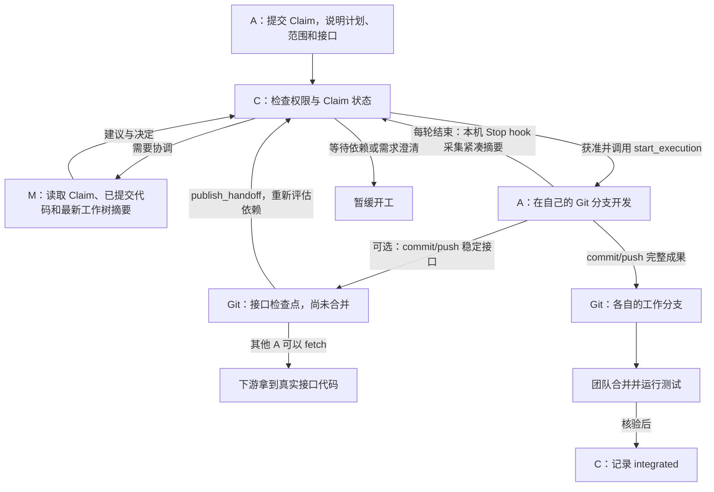

# TCA：在代码尚未合并时协调多人开发

[English](README.md) · [演示视频](docs/assets/tca-process-demo.mp4)

## 为什么需要它

上游开发者正在改库存模块，甚至准备改变 `reserve()` 接口。代码还在他的电脑里，没有 commit，也没有合入主分支。下游开发者只看得到旧接口，却必须开始写结账模块。直接并行容易写出两套不兼容的假设；一直等上游合并，又会浪费可并行的时间。

TCA 让开发者**先披露意图，再修改共享代码**。上游即使暂时没有可见代码，也要把预计修改范围、接口和不确定点写成 Claim；协调者据此约定责任。下游需要精确代码时，上游可先在自己的分支提交稳定的**接口检查点**，无需等整个功能完成或合并主分支。

**边界：**TCA 不读取另一台电脑上尚未 commit 的源码。A 工作树的本机 hook 在每轮 Codex 对话结束时，自动上报带时间戳的**工作树摘要**：声明范围内的文件增删、Python 函数/方法和接口签名变化。M 可以据此发现变化中的接口，但摘要不能代替真实实现，也不能说明完整行为。Claim 解决“计划做什么”，工作树摘要解决“上一轮结束时改动到哪里”，分支上的接口检查点解决“拿到可运行的具体代码”。

## 角色与 harness

这里的 **harness** 是包在 Codex 等编码 Agent 外面的执行与协调规则：何时披露 Claim、什么状态可以开工、M 看哪些上下文、怎样交接接口、怎样报告完成。原来各 Agent 只看自己的 Git 快照；TCA 增加一份共享协调状态。

| 角色 | 职责 |
| --- | --- |
| **A：开发者** | 提交 Claim，获准后用自己的 Codex 和 Git 分支写代码；一台电脑最多一个会提交代码的 A。 |
| **M：协调者** | 只读 Claim、已提交代码和 A 上报的未提交改动摘要，为各 A 明确责任、接口、依赖和验收建议；不提交业务代码，也拿不到未提交源码。 |
| **C：控制器** | 保存权威状态，检查规则和权限，处理 M 的决定，拒绝过期协调结果；不代替代码审查和 Git 合并。 |
| **项目创建者** | 用有仓库管理权限的账号启动项目、委派 M、核验最终集成；不必亲自担任 M。 |

下面这张图展示 harness 在开发流程中的位置。每位 A 都要先提交自己的 Claim；需要协调时，M 参与决定。独立任务可由 C 直接放行，M 仍可收到不阻塞开工的观察任务。



**未提交的源码仍只在开发者本机。**工作树摘要只传文件名、符号和接口形状等有限元数据；M 无法从中取得完整代码。需要真实接口时，拥有者仍须发布 Git 检查点。下游 A 也必须获得自己的开工许可。

有写权限的项目创建者可以在**两个独立工作树**中分别担任一个只读 M 和一个 A。每个开发者仍只用自己的 GitHub 账号提交自己的代码。

## 协议与状态

1. A 提交 **Claim**：目标、预计路径与符号、行为契约、依赖、Git 基线及工作分支。Claim 通过 TCA MCP 直接发送，不需要 Claim 分支或 webhook。
2. C 检查已声明边界。需要协调时，M 领取任务，分别向有关 A 提建议并提交决定。A 查询 `wait_for_decision` 或 `get_claim_state`；只有 `allowed_actions` 包含 `start_execution`，才能调用它开始修改共享代码。
3. A 在自己的分支开发，可报告进度。接入时 `tca-codex` 在 A 的工作树安装本机 Codex `Stop` hook；用户须在 Codex 中信任该 hook。此后每轮结束，hook 自动从 Git 工作树提取文件增删、Python 函数与接口签名变化，把有限元数据发给 C；A 无须启动监测命令，也没有快照 MCP 工具。M 读取最近快照及时间戳；没有快照或快照已过期时，不能推断代码未变。静态摘要不能确定行为语义。需要让下游使用真实接口时，先 commit/push 接口检查点，再用 `publish_handoff` 声明 SHA、导出符号和行为契约；这不表示整个上游功能已完成。
4. A 完成后提交并 push，远程模式在工作树运行 `tca-client complete CLAIM_ID`。客户端核查分支、基线、远程提交、改动路径，以及已声明的 Python 顶层函数和类方法；服务端 Metadata-only GitHub App 无法独立读取私有仓库 diff，因此仍须审阅代码与 A 的报告。团队照常合并，项目创建者核验后确认 `integrated`。

| 状态 | 含义 |
| --- | --- |
| `assessing` | 正在审查或重新协调；不能开工。 |
| `approved` / `approved_with_constraints` | 获准；后者须遵守约束。A 仍须调用 `start_execution`。 |
| `waiting` | 等待接口交接或其他已声明依赖。 |
| `executing` | A 已开工，可报告进度、发布接口检查点。 |
| `needs_human` / `blocked` | 分别表示需要人澄清需求、当前方案不能放行。 |
| `expired` | 执行超时，尚无已验证交付；可补交 Git 完成凭据。 |
| `completed` / `integrated` | A 已报告交付 / 项目创建者已确认集成。**完成不等于合并。** |

### 冲突如何消解

- **开工前：**M 根据 Claim 分清共享文件、函数、数据格式与责任。必要时让一人拥有共享接口，另一人按接口开发；有接口依赖时可等检查点，不必等完整功能合并。
- **错峰到来：**A1 已开工、A2 已获建议但未开工、A3 又加入同组时，C 不打断 A1，却撤销 A2 旧批准，让 A2 与 A3 重新协调。旧建议留在历史中，不再作为当前建议；旧轮次或旧修订号的提交会被拒绝。若 A2 也已开工，M 只协调后来者。
- **交付后：**各 A 仍负责必要的 Git rebase/merge 与代码验证。TCA 减少盲目冲突，不保证所有修改都可机械合并，也不掩盖测试失败。M 超时且存在已声明共享边界时，C 不会无人审查就自动放行。

## 安装与接入

### C 已在线上：不同电脑共同使用

服务端使用共享数据库（推荐 Postgres）、HTTPS，以及只对目标仓库申请 **Metadata: read** 的 GitHub App。仓库管理员将 App 安装到目标 repo；它用于查询成员权限，不需要 Contents 或写权限。每个人自己安装 Codex 和 TCA CLI：

```bash
git clone https://github.com/yigezong/tca.git
cd tca
uv tool install --python 3.12 --force .
tca-codex login --server-url https://YOUR_TCA_HOST/mcp --login YOUR_GITHUB_LOGIN
```

首次登录会生成本机专用 Ed25519 密钥。若 CLI 提示公钥未登记，把**公钥**加到该 GitHub 账号的 SSH keys 页面，再重试。私钥不发给 TCA。登录后客户端保存约八小时有效的 TCA 专用会话，服务端只存其哈希。让启动 Codex 的环境读取会话：

```bash
export TCA_TOKEN="$(tca-codex token --server-url https://YOUR_TCA_HOST/mcp)"
```

不要把 `TCA_TOKEN`、GitHub token 或私钥放进聊天、仓库和截图。Codex 桌面版若不继承终端变量，应在其启动环境配置 `TCA_TOKEN` 后开启新任务。两人实验须在在线 C 部署包含“项目创建者同时可作 M 和 A”功能的版本，并在两台电脑更新 CLI。

项目创建者先在 M 工作树运行 `tca-codex start --repo PATH --server-url https://YOUR_TCA_HOST/mcp`，将生成的 `AGENTS.md`、`.agents/skills/`、`.tca/project.yaml`、`.gitignore` 提交推送；`.tca/agent-id` 只留本地。随后本人在另一工作树运行 `tca-codex join --role a --repo PATH --server-url https://YOUR_TCA_HOST/mcp`；另一位开发者运行 `tca-codex join --repo PATH --server-url https://YOUR_TCA_HOST/mcp`。各工作树运行 `tca-codex doctor --repo PATH`。A 工作树生成的 `.codex/hooks.json` 仅留本机，首次打开 Codex 时在设置中的 Hooks 审核并信任它；未经信任就不会采集。M 也可由创建者用 `tca-codex delegate-m` 委派给其他有读取权限的成员。

已接入旧版本的 A 工作树，更新 CLI 和线上 C 后重新运行 `tca-codex join --repo PATH --server-url https://YOUR_TCA_HOST/mcp --replace-local-config`，再审核新 hook。

### C 不部署云端

- **同一电脑试用：**从 TCA 源码目录运行 `sh scripts/install-codex.sh /absolute/path/to/repo`。本机 `tca_local` 与 SQLite 协调同机工作树；它不隔离不同人的身份，也不能让两台电脑共享状态。
- **两台电脑、C 放在其中一台：**C 仍须作为双方可访问的服务运行，配共享数据库、HTTPS 地址和相同的身份校验；可用受控内网或隧道提供 HTTPS。只在一台电脑启动 `tca_local`，另一台无法参加同一个实验。

实践案例与双电脑操作顺序见 [examples/README_zh.md](examples/README_zh.md)。
