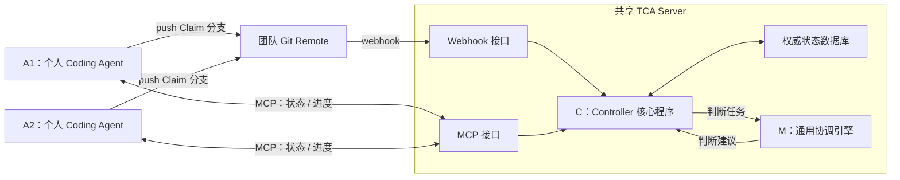
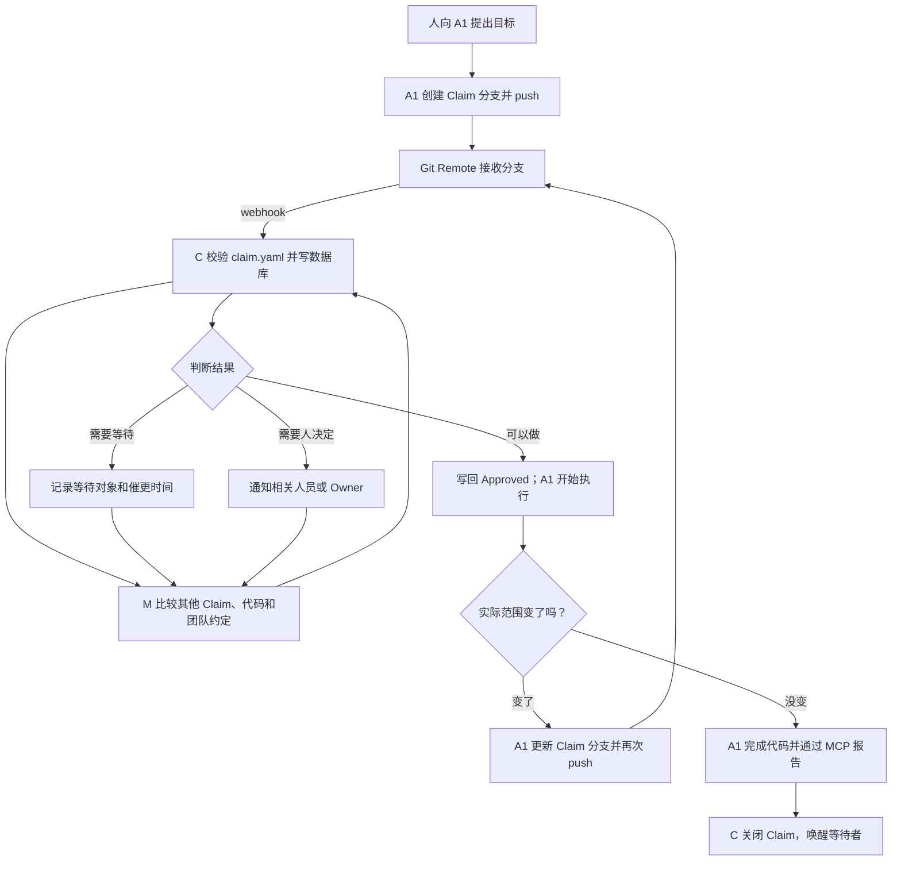

# Team Code Agent 项目说明

最后更新：2026-07-05

飞书链接：https://my.feishu.cn/wiki/YLuCwPwePiLeWzkEccKc9mqrnCh?from=from_copylink

## 1. 要解决的问题

AI coding agent 让单个开发者写代码的速度大幅提高，但团队协调速度没有同步提高。当多个成员各自带着 Agent，在同一个项目里并行工作时，会出现一组新的协作问题。

- **意图不可见**：别人只看到最终 diff，不知道某个 Agent 正准备做什么、为什么做、边界在哪里。
- **冲突发现太晚**：两项修改即使没有文本冲突，也可能同时改变同一个接口、数据模型或产品行为。
- **重复劳动**：多个 Agent 可能在不知道彼此存在的情况下解决同一个问题。
- **范围逐渐扩大**：任务可能从局部修复变成公共接口修改或大范围重构，但团队仍按最初的小任务理解它。
- **依赖和阻塞不清楚**：一项工作在等待谁、被等待的一方是否还在做、何时应该催更或释放，都没有统一记录。
- **目标不一定明确**：使用者可能只给 Agent 一个方向。团队协调者可以替他判断到什么程度、何时必须回来询问，需要明确边界。
- **上下文彼此割裂**：每个 Agent 只有自己的局部上下文，没有团队当前正在做什么的共同视图。
- **流程无法只靠 Prompt 保证**：Agent 可能忘记汇报、跳过步骤或误解约定，需要一个确定性程序控制关键状态。
- **Review 成本增加**：Reviewer 需要从大量代码反推最初目标、冲突处理和中途决策。

Git 和 Pull Request 仍然重要，但它们主要处理已经产生的代码。TCA 想补上的是代码进入共享范围之前和执行过程中的协调。

## 2. 最核心的方案

TCA 是一个以 C 为中心的共享服务。A 和 M 不直接通信，所有事件、判断与状态变化都经过 C。



两条输入通道最终都进入 C：

- Git 分支和 webhook 负责发布 Claim、amend 和代码事实。
- MCP 负责让 A 查询状态、接收约束、heartbeat、更新进度和报告完成。

C 是 TCA Server 中运行的核心普通程序；M 是 C 调用的语义判断模块。团队不需要为每个项目定制 M，也不需要部署多个 C。

## 3. C、M、A 到底是什么关系

关系可以压缩成一句话：**C 是唯一通信中枢和状态权威，A 与 M 都只和 C 交互。**

```text
A → C：Claim 事件、进度、范围变化、完成报告
C → M：需要判断的 Claim、活跃 Claim、代码事实和团队约定
M → C：冲突、依赖和协调建议
C → A：state、constraints 和 allowed_actions
```

### 3.1 C：核心控制程序

C 不需要使用 Agent 或 LLM，实现为普通后端程序即可。它负责：

- 接收 Git webhook 与 MCP 请求。
- 验证 repo、Agent、Claim 格式、权限和版本。
- 读写数据库并维护 Claim 状态机。
- 组织输入并调用 M。
- 校验 M 的输出是否合法、是否仍对应最新版本。
- 把结果转化为状态、约束和 `allowed_actions`。
- 通过 MCP 或 Git decision 把结果返回给 A。

C 不凭空制定业务目标。目标来自 P，语义协调建议来自 M，协议决定当前允许哪些动作；C 负责整合、记录和执行。

### 3.2 M：通用语义判断模块

M 可以由 LLM/Agent 实现，但不是一个自由运行、直接指挥 A 的团队成员。每次由 C 调用，并收到固定的 TCA system prompt、输入数据和输出 schema。

M 只负责：

- 理解多个 Claim 是否语义冲突。
- 判断依赖、共享边界和潜在风险。
- 建议批准、带约束批准、等待、阻塞或找人决定。
- 给出理由。

M 没有数据库写权限，也不能直接向 A 发命令。即使 M 输出了非法动作，C 也会拒绝。

### 3.3 A 从 C 得到什么

A 通过 MCP 查询 C，而不是直接询问 M。C 返回：

```yaml
claim_id: claim-42
state: approved_with_constraints
constraints:
  - 不修改 src/session/**
allowed_actions:
  - start_execution
  - amend_claim
  - abandon_claim
```

如果 MCP Client 不支持服务主动唤醒，A 使用 `wait_for_decision` 长轮询或定期调用 `get_claim_state`。C 同时可以把 decision 写回 Git，作为兼容方式和审计记录。

## 4. A1 到底怎样提交 Claim

### 4.1 用 Git 分支发布 Claim

A1 基于当前代码版本创建专门的 Claim 分支：

```text
分支：tca/claim/claim-42

.tca/
├── claim.yaml       # A1 写入
└── decision.yaml    # TCA 写回
```

`claim.yaml` 示例：

```yaml
claim_id: claim-42
author: agent-alice
base_commit: a1b2c3d
work_branch: feature/login-fix
goal: 修复登录重定向
planned_paths:
  - src/login/**
excluded_paths:
  - src/session/**
```

A1 执行：

```bash
git push origin tca/claim/claim-42
```

此时的接收链路是：

```text
A1 push
  → 团队现有 Git Remote 接收分支
  → GitHub/GitLab webhook 通知 TCA
  → C 拉取并校验 claim.yaml
  → C 写数据库并调用 M
  → C 把 decision 写回 Claim 分支或 Git status
```

所以：传输层接收者是 Git Remote，业务处理者是 C，语义理解者是 M。

### 4.2 MCP 仍然保留

MCP 不作为 Claim 的唯一提交方式，而是实时控制接口：

```text
get_claim_state       查询 Claim 状态
get_allowed_actions   查询下一步允许动作
heartbeat             报告 Agent 在线
update_progress       更新进度、等待或阻塞
request_coordination  请求人工协调
complete_claim        报告执行完成
```

不支持 MCP 的 Agent 仍能通过 Git 分支读取 `.tca/decision.yaml`；支持 MCP 的 Agent 可以立即查询结果和更新进度。

## 5. 状态在哪里维护

每个节点不各自维护一套权威状态机。所有权威状态都集中保存在 TCA 服务中，否则断线后很容易出现不同 Agent 各自认为自己是对的。

TCA 维护两类不同的状态。

### 5.1 Agent 的连接状态

Connection Manager 维护每个 A 是否在线：

```text
connecting → online → offline
```

连接过程：

1. A 通过 MCP 发送自己的身份、项目 ID、协议版本和认证 token。
2. TCA 校验通过后创建 session，将 A 标记为 `online`。
3. A 每隔一段时间发送 heartbeat。
4. 例如连续 90 秒没有 heartbeat，TCA 将 A 标记为 `offline`。
5. A 重连后使用原来的身份创建新 session，并从 TCA 重新读取工作状态。

### 5.2 工作的 Claim 状态

A 提交的“我准备做什么”称为工作声明，即 Claim。Controller 为每个 Claim 维护状态：

```text
已提交 → 正在判断 → 已批准 → 执行中 → 已完成
                    ↘ 等待 / 需要人决定 / 阻塞
```

Claim 状态回答的是“这项工作现在能不能继续”，而连接状态回答的是“这个 Agent 现在是否在线”。二者不能混为一谈：Agent 暂时离线，不代表它的工作立即失效；Agent 长期不更新后，Claim 才会被标记为 stale，并触发催更或释放流程。

A 本地可以缓存状态，但每次关键操作前都应重新查询 TCA。TCA 数据库里的版本才是权威版本。

## 6. 一次工作具体怎么走



以“修改登录流程”为例：

1. A1 创建 `tca/claim/claim-42`，写入 `.tca/claim.yaml`，然后 push 到团队现有 Git Remote。
2. GitHub/GitLab webhook 向 TCA 发出 push 事件。
3. C 读取 Claim，检查身份、格式和版本，写入数据库，状态变为 `Assessing`。
4. C 调用通用 M。M 发现 A2 正在修改共享 session 接口，建议登录 UI 可以先做，session 调用应等待。
5. C 校验建议并保存状态，把 `.tca/decision.yaml` 写回 Claim 分支；支持 MCP 的 A1 也可立即查询结果。
6. A1 执行期间通过 MCP heartbeat 和更新进度。
7. 如果范围扩大，A1 修改并再次 push Claim 分支，webhook 触发重新评估。
8. 完成后 A1 通过 MCP 报告完成；代码 push 和 PR 则由 Git 保存与审查。

## 7. Git、Webhook、MCP 与 TCA 怎样连接

### 7.1 Git Remote 不是 TCA 节点

Git Remote 就是团队已经在用的 GitHub、GitLab 或其他 Git 仓库。它负责保存 Claim 分支和代码，不维护 TCA 状态机。

Webhook 可以理解为 Git 平台在 push 后主动通知 TCA：

```text
GitHub/GitLab 收到 push
          ↓ HTTP POST
https://tca.example.com/webhooks/github
          ↓
C 处理事件
```

只要团队对 repo 有 webhook/App 安装权限，并且 TCA 有 Git 平台可访问的 HTTPS 地址，就可以接入普通 GitHub/GitLab repo。没有 webhook 时，原型也可以由 TCA 轮询 Claim 分支。

### 7.2 MCP 连接的是 Agent 与 TCA

支持 MCP 的 A 会连接 TCA 的 MCP 地址：

```text
A ──MCP──> https://tca.example.com/mcp ──> C
```

这个连接用于查询状态、heartbeat、进度和完成报告。它不替代 Git Claim 分支。

不支持 MCP 的 Agent 仍可完成 Claim 发布和读取 Git 中的 decision，但实时状态体验会弱一些；后续可以提供 `tca` CLI 调用同一套 HTTP API。

### 7.3 C 和 M 如何部署

C 与 M 是通用 TCA 后端的逻辑模块，不是每个团队都要定制的两个进程：

```text
通用 TCA 后端（托管版或统一容器）
├── Webhook 接入
├── MCP 接入
├── C：普通程序、状态机、数据库
├── M：通用 LLM/Agent 协调引擎
└── GitHub/GitLab Adapter
```

第一版可以把这些模块放在一个应用中，之后也可以拆分服务。无论怎样部署，所有团队共用同一套 C 和 M；项目差异来自 Claim、代码和 `.tca/agreements/`。

### 7.4 repo 配置

```yaml
project:
  id: proj_tca

tca:
  mcp_url: https://tca.example.com/mcp
  token_env: TCA_TOKEN

git:
  remote: origin
  claim_branch_prefix: tca/claim/
  decision_output: branch

connection:
  heartbeat_seconds: 30
  offline_after_seconds: 90
```

YAML 保存项目 ID、TCA 地址和 Git 约定，不保存实时状态或 token。实时状态统一保存在 C 的数据库中。

## 8. A 和 M 怎么知道要遵守 TCA

### 8.1 M 的协议由 C 强制注入

M 不需要自己发现 TCA。每次调用都由 C 固定传入：

- M 的角色和禁止事项。
- 当前 Claim 与相关活跃 Claim。
- 团队 Agreement 和代码事实。
- 允许返回的 decision schema。

M 只能向 C 返回判断建议；C 校验通过后才改变状态。因此 M 的遵从由 TCA 后端控制。

### 8.2 A 通过 MCP 获得协议说明

每个 A 都配置同一个远程 TCA MCP Server。连接时，MCP Server 提供 server instructions 和工具说明，例如：

```text
当 repo 存在 .tca/tca.yaml 时：
1. 修改代码前创建并 push Claim 分支。
2. 调用 wait_for_decision 等待 C 返回结果。
3. 只有 Approved 后才能开始共享修改。
4. 范围变化时更新 Claim 分支。
5. 完成时调用 complete_claim。
```

MCP 暴露的工具保持精简：

```text
wait_for_decision
get_claim_state
get_allowed_actions
heartbeat
update_progress
complete_claim
```

repo 中再保留一条人类可读规则，避免完全依赖不同 MCP Client 对 instructions 的处理：

```text
本项目启用了 TCA。修改代码前先 push Claim 分支，并通过 TCA MCP 等待批准。
```

这条规则可以写在项目通用说明中，再由接入脚本生成 Codex、Claude Code 或 Cursor 能自动读取的薄适配文件。

### 8.3 最终由 Git 门禁兜底

项目说明和 MCP instructions 用于引导，无法保证第三方 Agent 永不忽略。因此 Git CI/status check 做最终门禁：

- PR 或 commit 必须关联有效 `claim_id`。
- C 必须确认 Claim 已批准、未过期并属于当前 repo。
- 实际 diff 超出 Claim 的路径约束时，要求先 amend 并重新评估。
- 检查失败时，受保护分支禁止 merge。

因此三层职责是：

```text
MCP instructions + repo 规则：让 A 知道流程
C：让 A 和 M 不能非法改变状态
Git CI：让绕过流程的代码不能进入共享分支
```

## 9. 部署和团队配置

### 9.1 TCA Server 部署在哪里

TCA Server 部署一次，所有 A 连接同一个地址：

```text
https://tca.example.com
├── /mcp                  给所有 A 使用
├── /webhooks/github      接收 GitHub push
├── /webhooks/gitlab      接收 GitLab push
└── /health
```

如果使用 GitHub.com 或 GitLab.com，服务应部署在有 HTTPS 公网地址的云服务器、容器平台或 Git App 后端；如果团队使用内网 GitLab，TCA 也可以部署在同一内网。它不应长期运行在某个成员的个人电脑上。

第一版可用一个 Docker 容器运行 MCP 接入、webhook、C 和 M 调用逻辑，并使用 SQLite 持久化；正式多团队服务再换成 PostgreSQL 和多实例部署。

### 9.2 团队管理员配置一次

1. 部署或开通一个 TCA 项目，获得项目 ID、MCP 地址和 webhook 地址。
2. 给 GitHub/GitLab repo 安装 TCA App，或手工配置 push webhook。
3. 授权 TCA 读取 Claim 分支；若需要写回 `decision.yaml`，再授予该分支写权限。
4. 在 repo 中提交 `.tca/tca.yaml`、Agreement 和项目规则。
5. 配置 Git CI/status check，阻止无有效 Claim 的 PR 合并。

### 9.3 每个成员配置一次

每个成员只需要：

1. 保持原有 Git repo 权限。
2. 在自己的 coding agent 中添加同一个 TCA MCP 地址。
3. 使用自己的 TCA token，不能全团队共用 token。

```json
{
  "mcpServers": {
    "tca": {
      "type": "streamable-http",
      "url": "https://tca.example.com/mcp"
    }
  }
}
```

成员不需要部署服务器，也不需要配置自己的 M。所有 A 连接同一个 TCA Server，C 根据用户、Agent、project_id 和 repo 做隔离与授权。

### 9.4 第一版实现范围

第一版只实现一条闭环：

1. 一个通用 TCA Server，同时提供 webhook 与远程 MCP。
2. C 使用普通程序和数据库维护 Agent session、Claim、decision 与状态机。
3. A 通过 Git Claim 分支发布意图，webhook 触发 C 评估。
4. C 调用通用 M 判断冲突和依赖。
5. C 把 decision 写回 Git，A 通过 MCP 查询状态并汇报进度。
6. 范围变化再次 push Claim 分支；完成时通过 MCP 报告。
7. Git CI 阻止未批准或范围不符的修改合并。

第一版先支持一个 Git 平台 Adapter；暂时不做跨 repo 协调、复杂自动合并、企业权限后台和自动主持多人会议。

## 10. 还需要继续决定的事情

- TCA 服务部署在团队内网、云服务器，还是 Git 平台 App 后端。
- Git 门禁只限制 merge，还是也限制 push。建议第一版只限制受保护分支的 merge。
- 谁可以代表 P 或 Owner 作决定和 override。
- Agreement 谁能修改、何时生效。
- TCA、M 或 Git 断线时是否全部暂停。建议第一版默认暂停新的放行操作。
- M 可以读取多少代码和团队文档，敏感项目如何隔离。
