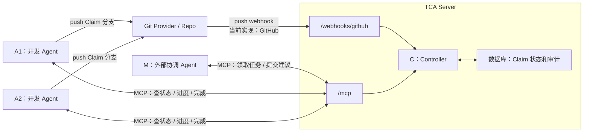
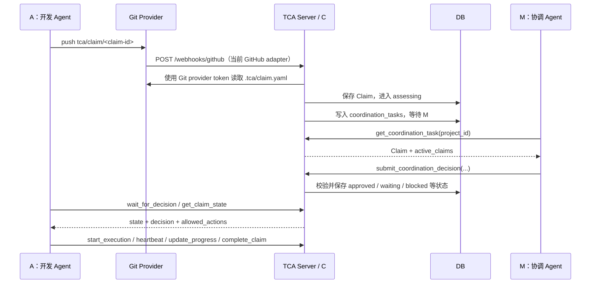
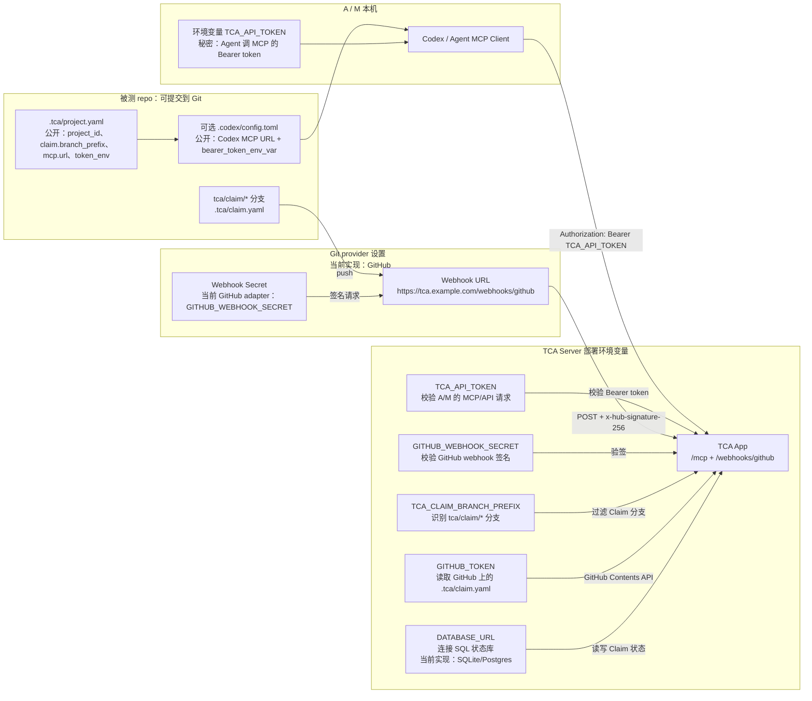

# TCA 指南：想法、实现与配置

最后更新：2026-07-20

这份文档是当前主文档。它合并了原来的 `project-idea.md`、线上部署说明和近期实现记录，但不应该丢掉 `project-idea.md` 里最重要的东西：**为什么需要 TCA、C/M/A 的关系、Git/Webhook/MCP 怎样各司其职**。

当前阶段仍然不使用 TCA 自举开发 TCA 本体。TCA 本体按普通 Git 流程开发；TCA 协议优先用于另一个被测 repo，等系统稳定后再考虑让 TCA 管理自己。

因此 TCA 本体仓库根目录不保留 `.tca/` 协议配置或 `.codex/` MCP 活配置。被测 repo 的最小接入模板保存在 `templates/test-repo/`。

## 1. TCA 要解决什么问题

AI coding agent 让单个开发者写代码更快，但团队协调速度没有同步提高。多个成员各自带着 Agent 在同一个 repo 里并行工作时，会出现一些新问题：

- **意图不可见**：别人只看到最终 diff，不知道某个 Agent 正准备做什么、为什么做、边界在哪里。
- **语义冲突发现太晚**：两项修改即使没有文本冲突，也可能同时改变同一个接口、数据模型或产品行为。
- **重复劳动**：多个 Agent 可能在不知道彼此存在的情况下解决同一个问题。
- **范围逐渐扩大**：任务可能从局部修复变成公共接口修改或大范围重构，但团队仍按最初的小任务理解它。
- **依赖和阻塞不清楚**：一项工作在等待谁、被等待的一方是否还在做、什么时候应该催更或释放，都没有统一记录。
- **目标不一定明确**：使用者可能只给 Agent 一个方向，系统需要区分“可由协调者判断”和“必须回问人”的边界。
- **上下文彼此割裂**：每个 Agent 只有自己的局部上下文，团队没有统一的活跃工作视图。
- **流程无法只靠 Prompt 保证**：Agent 可能忘记汇报、跳过步骤或误解约定，关键状态需要确定性程序控制。
- **Review 成本增加**：Reviewer 需要从大量代码反推最初目标、协调过程和中途决策。

Git 和 Pull Request 仍然重要，但它们主要处理已经产生的代码。TCA 想补上的是：**代码进入共享范围之前和执行过程中的协调**。

## 2. 核心模型

TCA 是一个以 C 为中心的共享协调服务。A 和 M 不直接互相指挥，所有事件、判断与状态变化都经过 C。



一句话版本：

```text
A 发布意图 → C 登记和控制状态 → M 给语义协调建议 → C 放行或约束 → A 执行并汇报
```

四个角色：

- **P（人）**：提出目标，处理机器无法裁决的业务决定。
- **A（开发 Agent）**：提出 Claim，获批后执行代码修改。
- **M（协调 Agent）**：理解多个 Claim 之间的语义冲突、依赖和风险，向 C 提交建议。
- **C（Controller）**：普通后端程序，维护状态机、校验权限、保存审计记录。C 是唯一权威状态源。

当前实现里，M 不打包在 TCA Server 内。M 是外部 Agent，和 A 一样通过 MCP 调 C。

## 3. 一次 Claim 怎么走



文本版流程：

1. A 在被测 repo 创建 `tca/claim/<claim-id>` 分支。
2. A 在该分支提交 `.tca/claim.yaml`。
3. A push Claim 分支到 Git provider。
4. Git provider webhook 通知 TCA Server。
5. C 校验 webhook 签名，读取远端 repo 上的 `.tca/claim.yaml`，写入数据库。
6. C 进入 `assessing`，并把任务放入 M 的协调队列。
7. M 通过 MCP 领取任务，提交 `approved` / `waiting` / `blocked` / `needs_human` 等建议。
8. C 校验 M 的建议并更新状态。
9. A 通过 MCP 读取状态；只有 `allowed_actions` 包含 `start_execution` 才能开始修改共享代码。
10. A 执行期间通过 MCP `heartbeat` / `update_progress`；完成后调用 `complete_claim`。

Git provider 是代码和 Claim 文件的事实来源；数据库是运行时状态机的事实来源。两者不能互相替代。

## 4. C、M、A 的关系

关系可以压缩成一句话：

> C 是唯一通信中枢和状态权威，A 与 M 都只和 C 交互。

```text
A → C：Claim 事件、进度、范围变化、完成报告
C → M：需要判断的 Claim、活跃 Claim、团队约定和代码事实
M → C：冲突、依赖、风险和协调建议
C → A：state、decision、constraints 和 allowed_actions
```

### 4.1 C：确定性控制程序

C 不需要使用 LLM。它是普通后端程序，当前主要在 `src/tca/controller.py`：

- 接收 Git provider webhook 与 MCP 请求。
- 验证 Claim 格式、版本、状态转换和权限。
- 读写数据库并维护 Claim 状态机。
- 做基础确定性规则检查，比如路径重叠和显式依赖。
- 把需要语义判断的 Claim 放入 M 的协调队列。
- 校验 M 的输出是否合法。
- 返回 `allowed_actions`，防止 A 或 M 越权改变状态。

C 不凭空制定业务目标。目标来自 P，语义协调建议来自 M，协议决定当前允许哪些动作；C 负责整合、记录和执行。

### 4.2 M：外部语义协调 Agent

M 可以由 LLM/Agent 实现，但它不是自由运行、直接指挥 A 的团队成员。

M 只负责：

- 理解多个 Claim 是否语义冲突。
- 判断依赖、共享边界和潜在风险。
- 建议批准、带约束批准、等待、阻塞或找人决定。
- 给出理由。

M 没有数据库写权限，也不能直接让 Claim 进入 `executing`。即使 M 输出非法动作，C 也会拒绝。

### 4.3 A 从 C 得到什么

A 通过 MCP 查询 C，而不是直接询问 M。C 返回类似：

```yaml
claim:
  claim_id: claim-42
state: approved_with_constraints
decision:
  constraints:
    - 不修改 src/session/**
allowed_actions:
  - start_execution
  - amend_claim
  - abandon_claim
```

如果 MCP Client 不支持服务主动唤醒，A 使用 `wait_for_decision` 长轮询或定期调用 `get_claim_state`。

## 5. 配置到底分几层

配置容易乱，是因为现在有三种东西长得都像“配置”，但职责不同。

```text
公开协议配置：放 repo 里，告诉所有 Agent 这个项目怎么接入 TCA
秘密运行配置：放部署环境 / Git provider / 本机环境里，保存 token 和 secret
Agent 适配配置：放 Codex / Claude / Cursor 自己的配置里，让具体工具知道怎么连 MCP
```

### 5.1 `.tca/project.yaml` 是协议配置

`.tca/project.yaml` 是被测 repo 里的公开配置。它告诉任何 Agent：

- 这个项目的 `project_id` 是什么。
- Claim 分支前缀是什么。
- Claim 文件路径是什么。
- TCA MCP URL 在哪里。
- token 应该从哪个环境变量名读取。

它可以提交到 Git，因为它不保存真实 token。

模板示例：

```yaml
version: 1
project_id: replace-with-owner/repo

git:
  transport: github
  remote_name: origin
  webhook_path: /webhooks/github

claim:
  branch_prefix: tca/claim/
  file: .tca/claim.yaml

mcp:
  url: https://replace-with-tca-server.example.com/mcp
  auth: bearer-token
  token_env: TCA_API_TOKEN

coordination:
  agreements_dir: .tca/agreements
```

### 5.2 `.codex/config.toml` 是 Codex 适配配置

`.codex/config.toml` 不是 TCA 协议的一部分。它只是 Codex 这个客户端的 MCP 连接配置。

如果某个被测 repo 要让 Codex 自动连接 TCA，Codex 目前还不会自动读取 `.tca/project.yaml` 来注册 MCP server。它需要自己的配置层告诉它：

```toml
[mcp_servers.tca]
url = "https://tca-ten.vercel.app/mcp"
bearer_token_env_var = "TCA_API_TOKEN"
```

所以这不是两个 TCA 协议配置源，而是：

```text
被测 repo 的 .tca/project.yaml      = TCA 协议事实来源
本机或生成的 .codex/config.toml    = Codex 连接 MCP 的薄适配层
```

如果两者不一致，应该以 `.tca/project.yaml` 为准，然后更新或重新生成 `.codex/config.toml`。

长期更好的方案是做一个接入命令，例如：

```bash
tca init codex
```

它读取 `.tca/project.yaml`，自动生成 Codex、Claude Code 或其他 Agent 需要的本地配置。这样用户只维护一份 `.tca/project.yaml`，不会手动写两遍 URL。

TCA 本体仓库不提交 `.codex/config.toml`，避免看起来像正在用 TCA 管理自己。被测 repo 可以选择生成或提交不含 secret 的 Codex 适配配置；每个成员仍然只在本机提供 `TCA_API_TOKEN`。

### 5.3 `.env.example` 是环境变量模板

`.env.example` 只是告诉开发者和部署者“需要哪些变量”。它只放占位值，不写真 token。

真实值应该放在：

- TCA Server 的部署环境变量。
- Git provider 的 webhook 设置。
- 成员本机 shell / Codex 环境。

### 5.4 `.env` 是本地秘密文件

如果本地要跑 TCA Server，可以创建 `.env`。这个文件不能提交，已经在 `.gitignore` 中。

例如：

```bash
TCA_API_TOKEN=本机测试token
GITHUB_WEBHOOK_SECRET=本机测试webhook-secret
GITHUB_TOKEN=本机GitHub token
```

## 6. Key 和环境变量在哪里起作用

这张图是最重要的配置图。它回答：每个 key 放在哪里、谁用它、在哪一步起作用。



### 6.1 变量职责表

| 名称 | 放在哪里 | 谁用 | 作用 | 是否 secret |
|---|---|---|---|---|
| `DATABASE_URL` | Server env；本地可选 | TCA Server | 连接 SQL 状态库。当前支持 Postgres；未设置时本地使用 SQLite | 是 |
| `TCA_DATABASE` | 本地 `.env` 可选 | TCA Server 本地开发 | SQLite 文件路径，默认 `tca.db` | 否 |
| `TCA_API_TOKEN` | Server env + A/M 本机环境 | Server 和 A/M | A/M 调 `/mcp`、`/api` 时的 Bearer token；Server 用同一个值校验 | 是 |
| `TCA_CLAIM_BRANCH_PREFIX` | Server env 可选；`.tca/project.yaml` 公开记录 | TCA Server | 只处理这个前缀的分支，例如 `tca/claim/`；默认就是 `tca/claim/` | 否 |
| `GITHUB_WEBHOOK_SECRET` | Server env + GitHub webhook 设置 | TCA Server 和 GitHub | 当前 GitHub adapter 使用：GitHub 发 webhook 时用它签名，TCA 用它验签 | 是 |
| `GITHUB_TOKEN` | Server env；本地 `.env` 可选 | TCA Server | 当前 GitHub adapter 使用：从 GitHub 读取 `.tca/claim.yaml` | 是 |
| `GITHUB_API_URL` | Server env 可选 | TCA Server | 当前 GitHub adapter 使用：GitHub API 地址，默认 `https://api.github.com` | 否 |
| `TCA_CLAIM_PATH` | Server env 可选 | TCA Server | Claim 文件路径，默认 `.tca/claim.yaml` | 否 |
| `TCA_ALLOWED_HOSTS` | Server env 可选 | MCP Server | MCP transport security 的允许 host 列表 | 否 |
| `TCA_HOST` / `TCA_PORT` / `TCA_MCP_PORT` | 本地运行可选 | TCA Server | 本地监听地址和端口；托管 ASGI 部署通常不需要手动设置 | 否 |

### 6.2 三把容易混的钥匙

| 名称 | 谁拿着 | 用在哪条链路 | 类比 |
|---|---|---|---|
| `TCA_API_TOKEN` | Server env + A/M 本机 | A/M → TCA `/mcp` 和 `/api` | Agent 进 TCA 前台的门禁卡 |
| `GITHUB_WEBHOOK_SECRET` | Server env + GitHub webhook 设置 | GitHub → TCA `/webhooks/github` | GitHub 敲门时的暗号 |
| `GITHUB_TOKEN` | Server env | TCA → GitHub API | TCA 去 GitHub 读 Claim 文件的钥匙 |

这三者不能互换。

## 7. 部署时怎么配置

### 7.1 最小必要配置

从用户心智上，TCA 接入应该只有三件事：

```text
Server：部署 TCA，并给它数据库和 Git 访问钥匙
Repo：提交 .tca/project.yaml，说明 Claim 和 MCP 地址
Agent：配置 MCP，并在本机提供 TCA_API_TOKEN
```

不应该要求普通成员理解 Vercel、Neon 或某个 Git 平台的细节。那些只是当前部署和 adapter 的实现选择。

### 7.2 TCA Server

必需环境变量：

```bash
DATABASE_URL=...
TCA_API_TOKEN=...
GITHUB_WEBHOOK_SECRET=...
GITHUB_TOKEN=...
```

可选环境变量：

```bash
TCA_CLAIM_BRANCH_PREFIX=tca/claim/
TCA_CLAIM_PATH=.tca/claim.yaml
GITHUB_API_URL=https://api.github.com
```

说明：

- `DATABASE_URL` 是状态库接口。当前实现支持 Postgres；本地开发可以不设，自动使用 SQLite。
- `GITHUB_*` 是当前 GitHub adapter 的配置。未来如果换成 GitLab、自托管 Git 服务或自定义 Git server，应该替换成对应 adapter 的配置，而不是让 TCA 协议变成 GitHub 专用协议。
- `TCA_CLAIM_BRANCH_PREFIX` 有默认值，除非团队想换分支命名，否则不用配。
- 不再有 `TCA_COORDINATION_MODE`。TCA 的默认前提就是：M 是外部协调 Agent，C 总是把需要语义判断的 Claim 排队给 M。

### 7.3 Git provider webhook

当前实现是 GitHub adapter，所以在被测 repo 的 GitHub Settings → Webhooks 中配置：

```text
Payload URL: https://<tca-domain>/webhooks/github
Content type: application/json
Secret: 与 TCA Server 环境变量 `GITHUB_WEBHOOK_SECRET` 完全相同
Events: Push events
```

Webhook 只负责通知 TCA “有分支 push 了”。TCA 收到通知后，还需要用 Git provider token 去远端 repo 读取 `.tca/claim.yaml`。

如果以后换成 GitLab 或自托管 Git 服务，应保持同一抽象：

```text
Git provider 收到 Claim 分支 push
  → 调用 TCA webhook
  → TCA 验证事件
  → TCA 读取 .tca/claim.yaml
```

### 7.4 被测 repo

被测 repo 需要提交：

```text
AGENTS.md
.tca/protocol.md
.tca/project.yaml
.tca/claim.example.yaml
.tca/agreements/README.md
```

这些文件不放 secret，只放协议和公开约定。

TCA 本体仓库提供了最小模板：

```text
templates/test-repo/AGENTS.md
templates/test-repo/.tca/protocol.md
templates/test-repo/.tca/project.yaml
templates/test-repo/.tca/claim.example.yaml
templates/test-repo/.tca/agreements/README.md
```

创建新被测 repo 时复制这些文件，并替换 `project_id`、`mcp.url` 等占位值。

### 7.5 A / M 成员本机

每个成员最少需要：

```bash
export TCA_API_TOKEN=团队给你的token
```

Codex 用户如果被测 repo 或本机已有 `.codex/config.toml`，通常不需要再手写 MCP URL；Codex 会从配置里看到 MCP server，并从环境变量 `TCA_API_TOKEN` 读取 token。

如果不是 Codex，则对应 Agent 需要用自己的方式配置 MCP URL 和 Bearer token。长期目标是由 `tca init <agent>` 从 `.tca/project.yaml` 自动生成。

## 8. 当前代码文件地图

### 根目录

| 文件 | 作用 |
|---|---|
| `README.md` | 项目入口，说明 TCA 是什么、怎么本地开发、主文档在哪 |
| `AGENTS.md` | Codex/Agent 进入本仓库时的工作规则 |
| `pyproject.toml` | Python 包元数据、依赖、命令入口、pytest 配置 |
| `uv.lock` | 锁定依赖版本 |
| `app.py` | ASGI 托管入口，导入 `src/tca/app.py` 中的 app；当前可用于 Vercel |
| `vercel.json` | Vercel serverless 函数配置；当前托管组合使用 |
| `Dockerfile` | 容器部署入口；当前不是主推荐路径 |
| `.env.example` | 本地/线上环境变量模板，不含真实 secret |
| `.gitignore` | 忽略虚拟环境、数据库、缓存和 `.env` |
| `templates/test-repo/` | 被测 repo 接入模板；TCA 本体根目录不直接保留 `.tca/` 活配置 |

### `templates/test-repo/`

| 文件 | 作用 |
|---|---|
| `templates/test-repo/AGENTS.md` | 被测 repo 的 Agent 入口规则 |
| `templates/test-repo/.tca/protocol.md` | TCA 协议的最小运行规则：A/M/C/P 怎么交互，哪些状态权威 |
| `templates/test-repo/.tca/project.yaml` | 项目级 TCA 配置模板：项目 ID、Claim 分支前缀、MCP 地址、token 环境变量名 |
| `templates/test-repo/.tca/claim.example.yaml` | Claim 文件示例，供被测 repo 或开发者参考 |
| `templates/test-repo/.tca/agreements/README.md` | 团队约定目录说明。未来可放 owner、依赖、优先级、冲突规则等 |

### `src/tca/`

| 文件 | 作用 |
|---|---|
| `app.py` | Starlette HTTP 应用：`/health`、GitHub webhook、`/api/claims/*`、MCP 挂载、Bearer 鉴权 |
| `controller.py` | C 的核心状态机：提交 Claim、审批、执行、进度、完成、协调队列 |
| `domain.py` | 领域模型：`Claim`、`Decision`、`ClaimRecord`、状态枚举、允许动作 |
| `rules.py` | 不依赖 LLM 的基础规则检查，比如路径重叠、依赖等待 |
| `store_protocol.py` | Store 接口协议，定义 Controller 需要的存储能力 |
| `store.py` | SQLite 本地存储实现；无 `DATABASE_URL` 时使用 |
| `postgres_store.py` | Postgres 存储实现；托管部署使用 |
| `github.py` | 当前 GitHub adapter：webhook 处理、HMAC 校验、从 GitHub 读取 Claim 文件 |
| `mcp_server.py` | MCP 工具定义：A/M 通过这些工具读取状态、汇报进度、提交协调建议 |

### `tests/`

| 文件 | 作用 |
|---|---|
| `tests/test_controller.py` | 测 Controller 状态机、基础冲突规则、M 协调流程 |
| `tests/test_github.py` | 测 GitHub webhook、签名校验、Claim 分支读取 |
| `tests/test_app.py` | 测 HTTP 鉴权、Server token 要求 |

## 9. 当前实现和理想模型的差距

当前已经有：

- GitHub webhook 接收 Claim 分支 push。
- 从 GitHub Contents API 读取 `.tca/claim.yaml`。
- SQLite / Postgres 两套 Store。
- Controller 状态机。
- 基础路径冲突和显式依赖规则。
- M coordination 队列。
- MCP 工具：A 查状态和汇报，M 领取任务和提交建议。

还没有完整实现：

- 自动唤醒 M 的 Runner。
- A 获批后的自动恢复/通知。
- GitHub status check / CI 门禁。
- 多用户 token、项目级权限和审计后台。
- 从 `.tca/project.yaml` 自动生成各 Agent 的本地 MCP 配置。

如果某个被测 repo 同时保存 `.tca/project.yaml` 和 `.codex/config.toml`，看起来会“写两遍 MCP URL”。本质上是还缺一个自动生成适配配置的接入工具。这个应该是后续产品化要消掉的摩擦；TCA 本体仓库自身不保留这两类活配置。

## 10. TCA 本身更新后，被测 repo 要不要重新配置

分情况：

| TCA 改了什么 | 被测 repo 是否要改 |
|---|---|
| 只改 TCA Server 内部 bug、状态机实现、存储实现 | 不需要。重新部署 TCA Server 即可 |
| MCP URL 没变，token 没变 | 不需要。A/M 重启最多只是为了刷新本地 MCP 连接 |
| MCP URL 变了 | 需要改被测 repo 的 `.tca/project.yaml`；如果被测 repo 里提交或生成了 `.codex/config.toml`，也要同步更新或重新生成 |
| `TCA_API_TOKEN` 轮换 | repo 文件不用改，但每个成员本地 secret 要更新 |
| Claim schema 改了 | 需要更新被测 repo 的 `.tca/claim.example.yaml`、`AGENTS.md`、可能还有 Agent 指令 |
| 协议规则改了 | 需要更新被测 repo 的 `.tca/protocol.md` |
| 团队约定改了 | 更新被测 repo 的 `.tca/agreements/` |
| Claim 分支前缀改了 | 需要同步改 Server env `TCA_CLAIM_BRANCH_PREFIX` 和 `.tca/project.yaml` |

理想状态是：TCA Server 可以频繁升级；被测 repo 只有在“协议、schema、地址、token、分支约定”变化时才需要重新配置。

## 11. 近期建议

1. 保持 TCA 本体不自举，继续普通开发和测试。
2. 保留 `docs/tca-guide.md` 作为主文档，不再把产品想法和部署说明散在多个入口。
3. TCA 本体根目录保持无 `.tca/` 和 `.codex/` 活配置；接入文件只作为 `templates/test-repo/` 模板存在。
4. 把被测 repo 的 `.tca/project.yaml` 视为协议事实来源；后续用脚本从它生成 Codex、Claude Code 等 Agent 适配配置。
5. 新建独立被测 repo，例如 `tca-playground`，在那里配置 `.tca/`、`AGENTS.md`、GitHub webhook，并跑第一轮 A/M 协调闭环。
