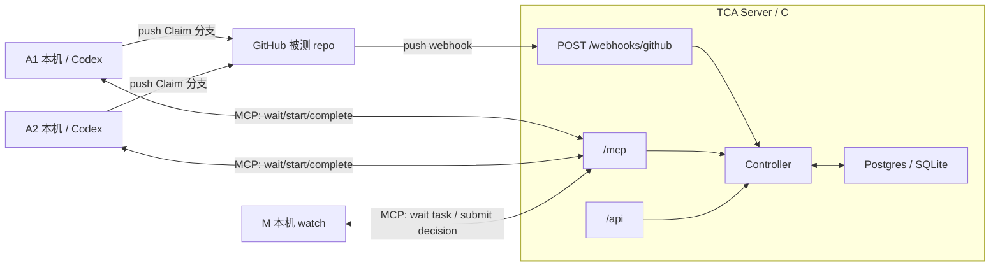
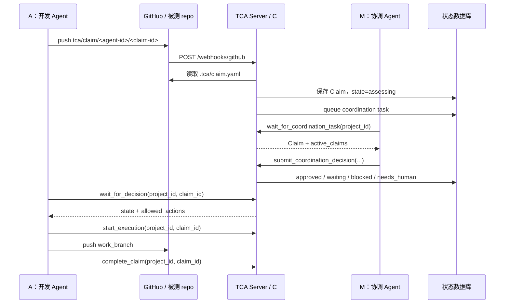

# TCA 指南

TCA 是一个 Git-first 的多 Agent 协作控制服务。它不替代 Git、PR 或 CI；它只在 Agent 改共享代码前，提供一个权威状态机，让团队知道每个 Agent 的意图、范围、冲突、依赖和放行条件。

本仓库是 TCA Server 源码仓库，不是被测 repo。当前不使用 TCA 自举开发本仓库，所以根目录不放 `.tca/`、`.codex/` 或其它活配置。被测 repo 接入模板在 `templates/test-repo/`。

## 1. 角色和边界

| 角色 | 运行位置 | 职责 |
|---|---|---|
| C / Controller | TCA Server，通常部署在 Vercel | 维护 Claim 状态机、校验状态转换、保存协调队列 |
| A / 开发 Agent | 用户本机、Codex task、CI worker | 提交 Claim，等 C 放行，执行代码修改，完成 Claim |
| M / 协调 Agent | 用户本机或团队机器，不默认云上常驻 | 领取待协调 Claim，判断冲突/依赖/风险，向 C 提交建议 |
| P / 人 | 人 | 提出目标，在机器无法自动裁决时决策 |
| Git provider | GitHub 等 | 保存 Claim 分支、工作分支和代码历史 |

关键边界：

- C 是唯一权威状态源。A/M 不能直接改数据库。
- M 不内置在 TCA Server 里。M 是外部 Agent，通过 MCP 调 C。
- TCA Server 保持轻量；昂贵的 Agent 不默认部署到云上。
- 当前没有 TCA 主动唤醒 Codex task。A/M 必须主动 long-poll；如果 Codex task 已经结束，TCA 不会让它自动复活。



## 2. 一次 Claim 的完整流程



A 的流程：

1. 从目标分支创建 `tca/claim/<agent-id>/<claim-id>`。
2. 在该分支提交 `.tca/claim.yaml`。
3. Push Claim 分支，让 GitHub webhook 通知 TCA。
4. 调用 `wait_for_decision(project_id, claim_id)`。
5. 只有 `allowed_actions` 包含 `start_execution` 时，调用 `start_execution`。
6. 从目标分支创建 `work_branch`，修改代码，提交并 push `work_branch`。
7. 工作分支已保存到 Git provider 后，调用 `complete_claim`。

M 的流程：

1. 本机启动 `tca-client watch`。
2. watch 循环调用 `wait_for_coordination_task(project_id)`。
3. 如果发现 active Claim 路径冲突，提交 `waiting`。
4. 如果没有 active 路径冲突，提交 `approved`。
5. 处理完一条后继续等下一条。

当前 `tca-client watch` 只是轻量 runner。它做的是路径级自动判断，不是完整语义审查。更复杂的 M 可以在同一个 MCP 协议上实现。

## 3. 状态机

Claim 的身份是 `(project_id, claim_id)`。不同项目可以复用同一个 `claim_id`。

状态：

| 状态 | 含义 | 允许动作 |
|---|---|---|
| `received` | C 收到 Claim，准备评估 | 无 |
| `assessing` | 等待 M 决策 | `get_claim_state` |
| `waiting` | 被其它 active Claim 阻塞 | `get_claim_state` |
| `approved` | 已获批 | `start_execution` |
| `approved_with_constraints` | 带约束获批 | `start_execution` |
| `needs_human` | 需要人处理 | `get_claim_state` |
| `blocked` | 被阻断 | `get_claim_state` |
| `executing` | A 正在执行 | `complete_claim` |
| `completed` | 已完成 | 无 |

重要规则：

- `wait_for_decision` 会穿过 `received`、`assessing`、`waiting` 继续等，直到超时或出现最终可行动状态。
- `complete_claim` 后，C 会重新评估等待该 Claim 的其它 Claim。
- M 不能把 Claim 直接改为 `executing` 或 `completed`。
- A 没有 `start_execution` 权限时必须停止修改共享代码。

## 4. MCP/API 表面

当前保留的 MCP tools：

| Tool | 使用方 | 作用 |
|---|---|---|
| `submit_claim(claim)` | A / adapter | 非 GitHub 场景直接提交 Claim |
| `get_claim_state(project_id, claim_id)` | A/M | 查询权威状态、决策和 allowed_actions |
| `wait_for_decision(project_id, claim_id)` | A | 等待 Claim 离开中间等待态 |
| `start_execution(project_id, claim_id)` | A | 把获批 Claim 转为 `executing` |
| `complete_claim(project_id, claim_id)` | A | 把执行中的 Claim 转为 `completed` |
| `wait_for_coordination_task(project_id)` | M | 等待待协调 Claim；`project_id=""` 表示所有项目 |
| `submit_coordination_decision(...)` | M | 提交 M 的协调建议，由 C 校验并落库 |

HTTP API 只保留调试/检查用状态查询：

```text
GET /health
GET /api/claims/<claim_id>?project_id=<owner/repo>
POST /webhooks/github
POST /mcp
```

`/health` 不需要 token。`/api/*` 和 `/mcp` 需要：

```text
Authorization: Bearer <TCA_API_TOKEN>
```

GitHub webhook 用 `GITHUB_WEBHOOK_SECRET` 签名校验，不使用 `TCA_API_TOKEN`。

## 5. 配置

有三层配置，职责不要混：

| 层 | 放在哪里 | 是否提交 | 作用 |
|---|---|---|---|
| TCA Server 环境变量 | Vercel / 本机 | 不提交真实值 | 让 C 能启动、鉴权、连数据库、读 GitHub |
| 被测 repo 协议配置 | 被测 repo `.tca/` | 提交 | 告诉 A 这个项目的 project_id 和 MCP URL |
| 客户端本机运行配置 | `.env` 或 shell env | 不提交真实值 | 给 A 提供 token 和 agent id；给 M 提供 watch 目标 |

### TCA Server

最小部署变量：

```bash
TCA_API_TOKEN=replace-with-random-token
DATABASE_URL=replace-with-postgres-url
TCA_ALLOWED_HOSTS=tca.example.com
```

启用 GitHub webhook 时再加：

```bash
GITHUB_WEBHOOK_SECRET=replace-with-webhook-secret
GITHUB_TOKEN=replace-with-github-token
```

说明：

- `TCA_API_TOKEN`：A/M 调 `/mcp` 和 `/api` 的 Bearer token；Server 用它校验。
- `DATABASE_URL`：线上 Postgres 连接串；未设置时本地 SQLite。
- `TCA_ALLOWED_HOSTS`：MCP transport 的 Host header 白名单，填 TCA Server 域名，不带 `https://`。
- `GITHUB_WEBHOOK_SECRET`：GitHub webhook secret；GitHub 用它签名，TCA 用它验签。
- `GITHUB_TOKEN`：TCA 从 GitHub Contents API 读取 `.tca/claim.yaml`。

### 被测 repo

复制 `templates/test-repo/` 后，改 `.tca/project.yaml`：

```yaml
version: 1
project_id: owner/repo
mcp:
  url: https://tca.example.com/mcp
  token_env: TCA_API_TOKEN
```

Claim 文件固定为 `.tca/claim.yaml`。

Claim 分支固定为：

```text
tca/claim/<agent-id>/<claim-id>
```

`<agent-id>` 必须等于 `.tca/claim.yaml` 的 `author`。`<claim-id>` 必须等于 `.tca/claim.yaml` 的 `claim_id`。

### A 本机

A 在被测 repo 工作区运行，默认从 `.tca/project.yaml` 读取 `project_id` 和 MCP URL。

本机 `.env`：

```bash
TCA_API_TOKEN=...
TCA_AGENT_ID=agent-a1
```

A 可用命令：

```bash
uv run --project /path/to/proj_tca tca-client wait <claim_id>
uv run --project /path/to/proj_tca tca-client start <claim_id>
uv run --project /path/to/proj_tca tca-client complete <claim_id>
```

### M 本机

M 不需要被测 repo checkout。M 可以在任意目录运行，只要有：

```bash
TCA_MCP_URL=https://tca.example.com/mcp
TCA_PROJECT_ID=owner/repo
TCA_API_TOKEN=...
```

启动常驻 watch：

```bash
uv run --project /path/to/proj_tca tca-client watch
```

只处理一条任务后退出：

```bash
uv run --project /path/to/proj_tca tca-client watch --max-tasks 1
```

空队列时退出，适合测试：

```bash
uv run --project /path/to/proj_tca tca-client watch --timeout 1 --idle-exit
```

## 6. GitHub 和 Vercel 怎么分清

`fringsoo/tca` 是 TCA Server 源码 repo。它和 Vercel 的关系是：

```text
fringsoo/tca push -> Vercel Git integration -> 部署 TCA Server
```

这条链路不需要在 `fringsoo/tca` 自己的 GitHub Webhooks 里配置 `/webhooks/github`。

`/webhooks/github` 是给被测 repo 用的：

```text
被测 repo push tca/claim/<agent-id>/<claim-id>
  -> GitHub webhook
  -> https://tca.example.com/webhooks/github
```

Webhook 配置：

- Payload URL：`https://<tca-server-host>/webhooks/github`
- Content type：`application/json`
- Secret：和 Server env `GITHUB_WEBHOOK_SECRET` 相同
- Events：`push`

## 7. 非 GitHub 场景

CooperBench 或其它非 GitHub git server 不走 `/webhooks/github`。它们可以直接通过 MCP `submit_claim(claim)` 提交同一份 Claim 数据。

这时仍然使用同一个状态机：

```text
submit_claim -> assessing -> M decision -> wait/start/complete
```

## 8. 当前文件地图

根目录：

| 文件 | 作用 |
|---|---|
| `README.md` | 项目入口和最小部署/使用说明 |
| `AGENTS.md` | 本仓库 Agent 工作规则 |
| `.env.example` | TCA Server 环境变量模板 |
| `.gitignore` | 忽略本地环境、缓存、数据库和 secret |
| `app.py` | Vercel ASGI 入口 |
| `vercel.json` | Vercel 函数配置 |
| `pyproject.toml` | Python 包、依赖、命令和测试配置 |
| `uv.lock` | 依赖锁 |
| `templates/test-repo/` | 被测 repo 接入模板 |

源码：

| 文件 | 作用 |
|---|---|
| `src/tca/app.py` | Starlette app，挂载 `/health`、`/api`、`/mcp`、`/webhooks/github` |
| `src/tca/mcp_server.py` | MCP tools |
| `src/tca/client_cli.py` | A/M 本机 CLI |
| `src/tca/controller.py` | 状态机和协调队列逻辑 |
| `src/tca/domain.py` | Claim、Decision、状态和 allowed_actions |
| `src/tca/rules.py` | C 侧确定性路径冲突检查 |
| `src/tca/github.py` | GitHub webhook 验签、Claim 分支解析、Claim 文件读取 |
| `src/tca/store.py` | SQLite store 和 store 构造入口 |
| `src/tca/postgres_store.py` | Postgres store |
| `src/tca/store_protocol.py` | Store 协议接口 |

测试：

| 文件 | 作用 |
|---|---|
| `tests/test_app.py` | HTTP 鉴权和 app 创建 |
| `tests/test_client_cli.py` | CLI 配置解析和 watch 决策 |
| `tests/test_controller.py` | 状态机 |
| `tests/test_github.py` | GitHub adapter |
| `tests/test_mcp_server.py` | MCP tools |
| `tests/test_store.py` | SQLite 迁移 |

## 9. 当前不做的东西

按极简原则，当前没有：

- TCA 自举配置：本仓库根目录不放 `.tca/` 或 `.codex/`。
- 产品级 M 服务：当前只有本机 `tca-client watch`。
- TCA 主动唤醒 Codex task：当前是 A/M 主动 long-poll。
- heartbeat、progress、abandon 等额外 tool。
- 自定义 Claim 分支前缀或 Claim 文件路径。
- GitHub status check / CI 门禁。
- 多用户 token、项目级权限和审计后台。
- 从 `.tca/project.yaml` 自动生成 Codex / Claude / Cursor 原生 MCP 配置。
