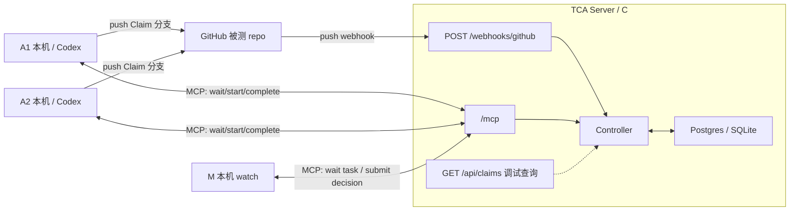
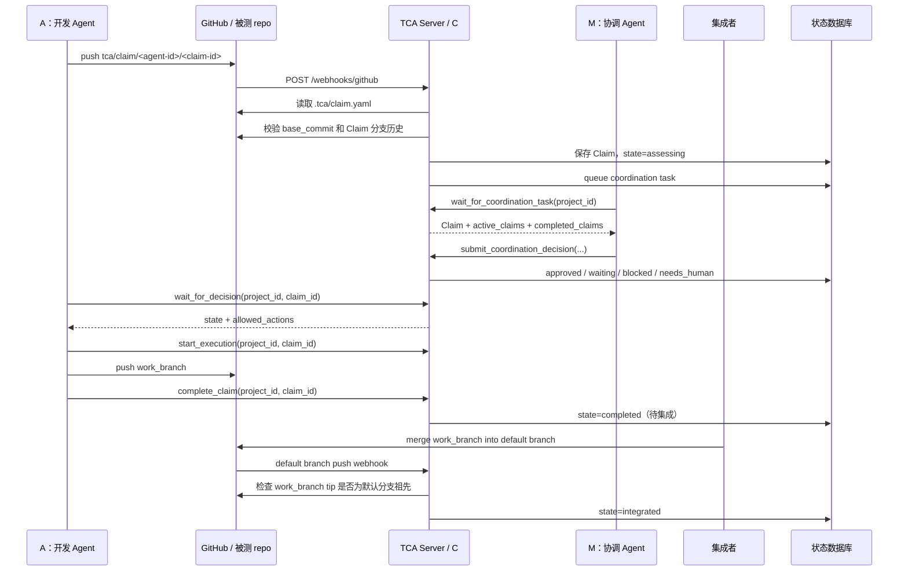

# TCA 指南

TCA 是一个 Git-first 的多 Agent 协作控制服务。它不替代 Git、PR 或 CI；它只在 Agent 改共享代码前，提供一个权威状态机，让团队知道每个 Agent 的意图、范围、冲突、依赖和放行条件。

本仓库是 TCA Server 源码仓库，不是被测 repo。当前不使用 TCA 自举开发本仓库，所以根目录不放 `.tca/`、`.codex/` 或其它活配置。被测 repo 接入模板在 `templates/test-repo/`。

原始项目讨论：[飞书文档](https://my.feishu.cn/wiki/YLuCwPwePiLeWzkEccKc9mqrnCh?from=from_copylink)

## Motivation：TCA 要解决什么问题

AI coding agent 让单个开发者写代码的速度大幅提高，但团队协调速度没有同步提高。当多个成员各自带着 Agent，在同一个项目里并行工作时，会出现一组新的协作问题。

- **意图不可见**：别人只看到最终 diff，不知道某个 Agent 正准备做什么、为什么做、边界在哪里。
- **冲突发现太晚**：两项修改即使没有文本冲突，也可能同时改变同一个接口、数据模型或产品行为。
- **重复劳动**：多个 Agent 可能在不知道彼此存在的情况下解决同一个问题。
- **范围逐渐扩大**：任务可能从局部修复变成公共接口修改或大范围重构，但团队仍按最初的小任务理解它。
- **依赖和阻塞不清楚**：一项工作在等待谁、被等待的一方是否还在做、何时应该催更或释放，都没有统一记录。
- **目标不一定明确**：使用者可能只给 Agent 一个方向。团队协调者可以替他判断到什么程度、何时必须回来询问，需要明确边界。
- **上下文彼此割裂**：每个 Agent 只有自己的局部上下文，没有团队当前正在做什么的共同视图。
- **流程无法只靠 Prompt 保证**：Agent 可能忘记汇报、跳过步骤或误解约定，需要一个确定性程序控制关键状态。
- **Review 成本增加**：Reviewer 需要从大量代码反推最初目标、冲突处理和中途决策。

Git 和 Pull Request 仍然重要，但它们主要处理已经产生的代码。TCA 想补上的是：**代码进入共享范围之前和执行过程中的协调**。

## 1. 角色和边界

| 角色 | 运行位置 | 职责 |
|---|---|---|
| C / Controller | TCA Server，通常部署在 Vercel | 维护 Claim 状态机、校验状态转换、保存协调队列 |
| A / 开发 Agent | 用户本机、Codex task、CI worker | 提交 Claim，等 C 放行，执行代码修改，完成 Claim |
| M / 协调 Agent | 用户本机或团队机器，不默认云上常驻 | 领取待协调 Claim，结合 Claim 元数据和 repo 只读上下文判断冲突/依赖/风险，向 C 提交建议 |
| 集成者 | 人、开发 Agent、集成 Agent 或 CI | 按团队正常 Git 流程把 completed 工作分支合入目标分支 |
| P / 人 | 人 | 提出目标，在机器无法自动裁决时决策 |
| Git provider | GitHub 等 | 保存 Claim 分支、工作分支和代码历史 |

关键边界：

- C 是唯一权威状态源。A/M 不能直接改数据库。
- M 不内置在 TCA Server 里。M 是外部 Agent，通过 MCP 调 C。
- TCA Server 保持轻量；昂贵的 Agent 不默认部署到云上。
- 当前没有 TCA 主动唤醒 Codex task。A/M 必须主动 long-poll；如果 Codex task 已经结束，TCA 不会让它自动复活。



## 2. 一次 Claim 的完整流程



A 的流程：

1. `git fetch origin`，把远端默认分支当前的完整 SHA 记录为 `base_commit`。
2. 从 `base_commit` 创建 `tca/claim/<agent-id>/<claim-id>`，在该分支提交 `.tca/claim.yaml`；`work_branch` 固定为 `feature/<agent-id>/<claim-id>`。
3. Push Claim 分支，让 GitHub webhook 通知 TCA。
4. 调用 `wait_for_decision(project_id, claim_id)`。
5. 只有 `allowed_actions` 包含 `start_execution` 时，调用 `start_execution`。
6. 从 Claim 的 `base_commit` 创建 `work_branch`，先满足 Decision 中的约束，再修改代码、提交并 push。
7. 工作分支已保存到 Git provider 后，调用 `complete_claim`。

首次接收 GitHub Claim 时，C 会验证 `base_commit` 等于当时远端默认分支最新提交，而且确实是 Claim 分支的祖先。旧 checkout 发出的 Claim 会被拒绝，A 必须重新 fetch 并重建 Claim 分支。Claim 后续因范围变化递增 `version` 时，可以修改目标、路径、排除项和依赖，但不能更换 `author`、`base_commit` 或 `work_branch`。

`complete_claim` 只表示“这个 Claim 的工作分支已经完成并推到 Git provider”。它不表示代码已经进入 `main`。completed Claim 会继续出现在 M 收到的协调上下文里；如果后续 Claim 与它重叠，M 必须要求后续 A 先检查并纳入该 `work_branch`，或者返回 `needs_human`。不能因为前一个 Agent 已结束就假设它的代码已经进入基线。

进入默认分支仍然走团队自己的 PR、merge、CI 或人工集成流程。集成者不需要操作 TCA：GitHub 默认分支收到 push 后，webhook 会触发 TCA 调用 GitHub compare API。只有 completed Claim 的 `work_branch` tip 确实是默认分支祖先时，C 才自动转为 `integrated`，并把它从后续协调上下文移除。

这个判断刻意保守。普通 merge commit 和 fast-forward 会保留祖先关系，可以自动确认；squash/rebase 会改写提交历史，TCA 无法仅凭 Git 历史可靠证明整项工作已经进入默认分支。关闭 webhook、使用其它 Git provider 或采用这类 merge 策略时，管理员核验代码后才使用 `integrate_claim` 兜底。普通 A 只做到 `complete_claim`，不承担集成状态记账。

M 的流程：

1. 在 `TCA_AGENT_ID=agent-m` 的独立 checkout 中启动一个已经配置好 TCA MCP 的 Agent；共享 `AGENTS.md` 会自动加载 M 工作规则。
2. watch 循环调用 `wait_for_coordination_task(project_id)`。
3. 如果 C 把一个 Claim 交给 M，M 根据 active Claim、completed-but-unintegrated Claim、语义冲突和风险提交决策。
4. 与仍 active 的路径重叠时使用 `waiting`；只与 completed 工作重叠时，使用 `approved_with_constraints` 要求纳入其工作分支，无法安全集成时使用 `needs_human`。
5. 处理完一条后继续等下一条。

CLI 尚未发布独立安装包，首次安装需要取得本仓库源码。A/M 随后使用 Codex 等客户端的原生 MCP 配置连接 TCA Server 的 `/mcp`。本仓库里的 `tca-client` 只是维护者本地开发和 smoke test 的辅助命令，不是正式用户流程的一部分。

当前 smoke M 只是轻量 runner。它做的是路径级自动判断，不是完整语义审查。更复杂的 M 可以在同一个 MCP 协议上实现。

M 不需要 TCA Server 源码，但不能凭空做语义判断。`wait_for_coordination_task` 返回 Claim 元数据和两组协调上下文：`active_claims` 是尚未完成的工作，`completed_claims` 是已完成但尚未集成的工作。它足够判断“计划路径是否重叠、依赖是否还没完成”。如果要判断“两个目标语义上是否冲突、如何纳入 completed 工作分支”，M 还需要 repo 上下文。正式方案有三种：

| M 上下文来源 | 适合场景 | 边界 |
|---|---|---|
| M 自己管理的本地只读 checkout | 本机/团队机器常驻 M | M 可以读文件、看 commit、看历史，但不复用 A 的工作区，也不写业务 repo |
| Git provider 只读访问 | M 不想保存 checkout | M 通过 GitHub/GitLab API 读 `base_commit`、路径和历史 |
| TCA Server 提供上下文摘要 | 以后做托管 M 或轻客户端 | 需要扩展 C 的 API，把必要文件片段/diff 安全地给 M |

现在的实现只提供前两层的接口基础，没有把 repo 文件内容塞进 TCA 状态机。这样保持 C 轻量，也避免把代码库内容长期存进 TCA 数据库。

C 在 M 之前还有一层确定性路径规则：如果新 Claim 的 `planned_paths` 已经和仍 active 的 Claim 重叠，C 会直接把它放到 `waiting`，暂时不生成 M task。等阻塞 Claim completed 后，C 重新评估等待项；completed 工作不再形成硬等待，但会作为协调上下文交给 M，由 M 决定后续 A 如何纳入该工作。GitHub webhook 确认工作已进入默认分支后，它才从上下文移除。

## 3. 状态机

Claim 的身份是 `(project_id, claim_id)`。不同项目可以复用同一个 `claim_id`。

状态：

| 状态 | 含义 | 允许动作 |
|---|---|---|
| `received` | C 收到 Claim，准备评估 | 无 |
| `assessing` | 等待 M 决策 | `get_claim_state` |
| `waiting` | 被其它 active Claim 阻塞 | `get_claim_state` |
| `approved` | 已获批 | `start_execution` |
| `approved_with_constraints` | 带约束获批 | `start_execution` |
| `needs_human` | 需要人处理 | `get_claim_state` |
| `blocked` | 被阻断 | `get_claim_state` |
| `executing` | A 正在执行 | `complete_claim` |
| `completed` | 工作分支已完成并 push，等待进入默认分支 | 无；等待 GitHub webhook 自动确认 |
| `integrated` | 工作已进入目标分支 | 无 |

重要规则：

- 新 Claim 从 `version: 1` 开始；修订必须递增，且不能改变身份、基线和工作分支。
- `wait_for_decision` 会穿过 `received`、`assessing`、`waiting` 继续等，直到超时或出现最终可行动状态。
- `complete_claim` 后，C 会重新评估等待该 Claim 的其它 Claim，并把 completed 工作保留在 M 的协调上下文里。
- GitHub 默认分支 push 后，C 只自动集成祖先关系得到证明的 completed Claim。
- `integrate_claim` 只用于无 webhook、非 GitHub 或 squash/rebase 等无法自动证明的场景，由管理员核验后调用。
- M 不能把 Claim 直接改为 `executing` 或 `completed`。
- A 没有 `start_execution` 权限时必须停止修改共享代码。

`waiting` 不是要求 A 立刻改 Claim。它的意思是：当前 Claim 暂时不能开始，因为 `wait_for` 里的其它 Claim 还 active。A 的默认动作是继续 `wait_for_decision`。当阻塞项 completed 后，C 会把等待中的 Claim 重新放回 `assessing`；M 会同时看到 completed Claim 的 `work_branch`，并决定要求 A 纳入该分支、继续等待集成，或交给人。只有当 A 想主动绕开冲突，比如缩小 `planned_paths` 或改依赖关系时，才需要提交新版 Claim，且 `version` 必须递增。

`wait_for_coordination_task(project_id)` 是给 M 用的取任务入口。它不是给 A 查自己状态的；A 用 `wait_for_decision`。M 调它时，C 会返回最早一个正在 `assessing` 的 Claim、同项目 `active_claims`，以及待集成的 `completed_claims`。M 根据这些信息提交 `approved`、`approved_with_constraints`、`waiting`、`blocked` 或 `needs_human`。

## 4. MCP/API 表面

当前保留的 MCP tools：

| Tool | 使用方 | 作用 |
|---|---|---|
| `submit_claim(claim)` | A / adapter | 非 GitHub 场景直接提交 Claim |
| `get_claim_state(project_id, claim_id)` | A/M | 查询权威状态、决策和 allowed_actions |
| `wait_for_decision(project_id, claim_id)` | A | 等待 Claim 离开中间等待态 |
| `start_execution(project_id, claim_id)` | A | 把获批 Claim 转为 `executing` |
| `complete_claim(project_id, claim_id)` | A | 把执行中的 Claim 转为 `completed` |
| `integrate_claim(project_id, claim_id)` | 管理员 / adapter | 自动确认不可用时，核验 completed 工作已进入目标分支并手动兜底 |
| `wait_for_coordination_task(project_id)` | M | 等待待协调 Claim；`project_id=""` 表示所有项目 |
| `submit_coordination_decision(...)` | M | 提交 M 的协调建议，由 C 校验并落库 |

HTTP API 只保留调试/检查用状态查询。它不是第二套协议，也不是 A/M 的正式入口；正式入口是 MCP。

```text
GET /health
GET /api/claims/<claim_id>?project_id=<owner/repo>
POST /webhooks/github
POST /mcp
```

`/health` 不需要 token。`/api/*` 和 `/mcp` 需要：

```text
Authorization: Bearer <TCA_API_TOKEN>
```

GitHub webhook 用 `GITHUB_WEBHOOK_SECRET` 签名校验，不使用 `TCA_API_TOKEN`。

`/api/claims/<claim_id>` 当前只等价于一次 HTTP 版 `get_claim_state`，方便人用 `curl` 或浏览器排查线上状态。如果以后觉得它增加理解成本，可以删掉；核心流程不依赖它。

## 5. 团队接入和配置归属

本节记录旧式共享 `TCA_API_TOKEN` 和 Claim webhook 接入流程，供已有部署迁移。新项目推荐使用 GitHub 用户身份鉴权：所有者启动 repo，开发者按自己的仓库权限自行加入。最新命令见 [中文 README](../README_zh.md)；英文入口见 [README](../README.md)。

先区分三种身份：TCA Server 管理者负责服务，项目发起者负责把一个 repo 接入服务，团队成员负责自己的开发环境。一个人可以兼任，但配置仍然只做在它所属的那一层。

| 配置 | 谁创建或设置 | 作用范围 | 放在哪里 | 是否提交 |
|---|---|---|---|---|
| TCA Server 环境变量 | Server 管理者 | 一个 TCA 服务 | Vercel / Server env | 否 |
| `.tca/`、`AGENTS.md` | 项目发起者 | 一个被测 repo | 被测 repo | 是 |
| GitHub webhook | 项目发起者 | 一个被测 repo | GitHub repo Settings | 否 |
| `TCA_API_TOKEN` | Server 管理者生成，成员只领取 | 当前为一个服务/团队共享 | MCP 客户端 secret store 或机器级环境 | 否 |
| 原生 MCP 连接 | 每位成员或机器管理员 | 一台机器/一个客户端 | Codex、Claude、Cursor 等客户端配置 | 否 |
| `TCA_AGENT_ID` | 每个 A/M 工作区设置 | 一个 clone/worktree | 工作区 `.env` 或本地环境 | 否 |
| GitHub 凭证 | 每位成员 | 一个 GitHub 用户 | credential manager / SSH agent | 否 |
| M 的 repo checkout | 运行 M 的人或团队机器 | 一个项目的 M | M 自己的本地目录 | 否 |

本节的旧式鉴权模型只有一个 Server 级共享 `TCA_API_TOKEN`。它表示“允许访问这个 TCA Server”，不是个人或项目身份：Server 管理者生成一次，获准访问该实例的成员领取同一个值。成员不应自行生成 token。工作区角色和 A 的身份来自 `TCA_AGENT_ID`，Git push 的人员权限来自各自的 GitHub 凭证。

旧式共享 token 不构成项目级权限隔离，因此只适合同一信任范围内的多个项目。GitHub 模式则在每次操作时核验用户身份和 repo 权限。

### TCA Server

最小部署变量：

```bash
TCA_API_TOKEN=replace-with-random-token
DATABASE_URL=replace-with-postgres-url
TCA_ALLOWED_HOSTS=tca.example.com
```

启用 GitHub webhook 时再加：

```bash
GITHUB_WEBHOOK_SECRET=replace-with-webhook-secret
GITHUB_TOKEN=replace-with-github-token
```

说明：

- `TCA_API_TOKEN`：Server 管理者生成一次的共享 Bearer token；A/M 调 `/mcp`、人用 `/api` 调试时复用它。
- `DATABASE_URL`：线上 Postgres 连接串；未设置时本地 SQLite。
- `TCA_ALLOWED_HOSTS`：MCP transport 的 Host header 白名单，填 TCA Server 域名，不带 `https://`。
- `GITHUB_WEBHOOK_SECRET`：GitHub webhook secret；GitHub 用它签名，TCA 用它验签。
- `GITHUB_TOKEN`：TCA 读取 `.tca/claim.yaml`，并用 GitHub compare API 验证 completed 工作分支是否进入默认分支。

### 项目发起者：一次性接入 repo

如果团队已有可用的 TCA Server，项目发起者不需要部署 `proj_tca`。只需：

1. 从 Server 管理者处取得 MCP URL、共享 `TCA_API_TOKEN` 和 webhook secret。
2. 把 `templates/test-repo/` 复制进被测 repo。
3. 修改 `.tca/project.yaml`，并把模板文件提交到默认分支。
4. 在被测 GitHub repo 配置一次 webhook。
5. 通过安全渠道把共享 token 发给获准成员。
6. 安排一个 M，在它自己的 repo checkout 中设置保留身份 `agent-m` 并持续等待协调任务。

`.tca/project.yaml`：

```yaml
version: 1
project_id: owner/repo
mcp:
  url: https://tca.example.com/mcp
  token_env: TCA_API_TOKEN
```

这里提交的是 MCP URL 和环境变量名，不是 token 的真实值。所有成员 clone 后自动得到这份项目配置。

Claim 文件固定为 `.tca/claim.yaml`。

Claim 分支固定为：

```text
tca/claim/<agent-id>/<claim-id>
```

`<agent-id>` 必须等于 `.tca/claim.yaml` 的 `author`。`<claim-id>` 必须等于 `.tca/claim.yaml` 的 `claim_id`。

发布新 Claim 前，A 先 fetch 远端默认分支，并把其完整 SHA 写入 `base_commit`。Claim 分支从这个提交创建，`work_branch` 固定为 `feature/<agent-id>/<claim-id>`。Webhook 会核对默认分支最新 SHA 和 Claim 分支祖先关系；因此旧基线不会悄悄进入 C。后续 Claim 修订沿用原来的 `author`、`base_commit` 和 `work_branch`。

Webhook 的 Payload URL、secret 和事件选择见第 6 节。一个 repo 只配置一次，不随成员或任务重复配置。

### 团队成员：每台机器一次

成员第一次加入时：

1. Clone 被测 repo，并配置自己的 GitHub 凭证。
2. 从项目发起者处领取共享 `TCA_API_TOKEN`，保存到 MCP 客户端的机器级环境或 secret store。
3. 按 `.tca/project.yaml` 中的 URL 配置客户端的原生 MCP 连接，并让 Bearer token 从 `TCA_API_TOKEN` 读取。
4. 确认客户端能看到 TCA MCP tools。

`token_env: TCA_API_TOKEN` 只是在声明环境变量名。它不会生成 token，也不意味着每个成员应该创建一个新 token。真实 token 不进入 repo、prompt 或日志。

新式 Codex 接入可使用 `tca-codex start` / `join` 自动配置 MCP；旧式其它客户端仍需按本节手动配置。

使用旧式手工配置的成员不需要 checkout TCA Server 源码，不需要配置被测 repo webhook，也不需要接触 `DATABASE_URL`、`GITHUB_TOKEN` 或 `GITHUB_WEBHOOK_SECRET`。目前新式 CLI 尚未发布独立安装包，首次安装需要取得 TCA 源码。

### A 工作区：每个并行 Agent 一个身份

A 在被测 repo 工作区运行，默认从 `.tca/project.yaml` 读取 `project_id` 和 MCP URL。

每个 A clone/worktree 从 `.env.example` 创建自己的 `.env`，只设置身份：

```bash
TCA_AGENT_ID=agent-a1
```

并行 A 使用不同的稳定值，例如 `agent-a1`、`agent-a2`。共享 token 已由机器级 MCP 客户端提供，不必复制到每个工作区。

成员日常只给 A 普通产品需求，不需要在 prompt 中说“扮演 A”或手动指导 Claim 步骤。A 读取 repo 中的 `AGENTS.md` 和 `.tca/protocol.md` 后自行提交 Claim、等待放行、执行、push 并完成 Claim。

A 的客户端必须能看到 TCA MCP tools。看不到时不要开始改共享代码，也不要自己生成 token；应报告机器级 MCP 配置未完成。

### M：项目级协调工作区

M 不需要 TCA Server 源码 checkout。推荐让 M 自己 clone 一份被测 repo，并直接以这个 repo 根目录作为 M task 的工作目录。这样 M 要看代码上下文时读当前目录就行，不需要额外路径变量。`project_id` 和 MCP URL 从当前 repo 的 `.tca/project.yaml` 读取。

指定这个 checkout 为 M 只做一次：复制本地环境模板，把内容设置为保留身份。

```bash
cp .env.example .env
git remote set-url --push origin DISABLED
```

```text
TCA_AGENT_ID=agent-m
```

`.env` 已被模板 `.gitignore` 忽略，只在这个 checkout 生效，不会把其它 A clone 变成 M。共享 `AGENTS.md` 读取到 `agent-m` 后会自动加载 `.tca/m-agent.md`，所以用户不再需要输入 M 角色说明、轮询命令或决策规则。当前版本仍需有人或本地启动器启动这个 task；long-poll 只能让已运行的 M 持续等待，不能让 TCA Server 主动创建或复活 Codex task。

M 的 MCP 客户端使用同一个团队 `TCA_API_TOKEN`。M 是项目级能力，不要求每位开发成员都运行一份；团队可以指定一台本机或团队机器常驻 M。

如果 M 只做路径级判断，可以只看 `wait_for_coordination_task` 返回的 Claim 元数据。如果 M 要做语义判断，就在自己的 repo checkout 里读文件、看 commit、比较 active claims 的目标和路径。不要让 M 复用 A 的工作区，因为 A 的工作区会有未完成修改、分支切换和测试副产物。

真实 M 的循环是 MCP tool 调用，不是 shell 命令：

1. 调 `wait_for_coordination_task(project_id)` 等待任务。
2. 看 Claim、active claims、目标和风险。
3. 调 `submit_coordination_decision(...)` 提交判断。
4. 继续等下一条。

本仓库维护者做 smoke test 时，当前还可以临时用仓库内置 CLI 充当 MCP 客户端；正式 smoke 应该让 M task 直接使用客户端原生 MCP tools。

### Long-poll 和主动唤醒

当前 TCA 用 long-poll：A/M 主动发一个“等一会儿”的请求给 C；如果这段时间内有状态变化，C 立即返回；如果没有变化，到超时时间后返回当前状态或空任务。客户端再发下一次请求。

主动唤醒是另一种模型：A/M 可以退出或睡死，C 在状态变化时主动调用某个回调、消息队列、Webhook、系统通知或 Codex task API，把对应 Agent 重新叫起来。主动唤醒更自动，但也更重：要维护回调地址、身份、重试、离线恢复、权限和队列。当前极简版本不做它，所以 M 要常驻调用 `wait_for_coordination_task`，A 要在自己的 task 里持续 `wait_for_decision`。

### 原生 MCP 配置生成

从 `.tca/project.yaml` 生成 Codex / Claude / Cursor 的 MCP 配置是有价值的，而且应该作为短期小功能做。它不需要进入 C 的状态机，只需要一个本地命令读取：

```yaml
mcp:
  url: https://tca.example.com/mcp
  token_env: TCA_API_TOKEN
```

然后输出各客户端需要的配置片段。注意真实 token 不应该写进生成文件，应该继续使用环境变量引用或让客户端自己的 secret 机制保存。

这件事应该优先做，因为它正好解决“用户机器没有 `proj_tca`”的问题。实现时可以加成一个独立的小生成器，例如 `tca mcp-config --target codex|claude|cursor`，只生成配置文本，不改用户全局配置。

## 6. GitHub 和 Vercel 怎么分清

本仓库是 TCA Server 源码 repo。它和 Vercel 的关系是：

```text
源码仓库 push -> Vercel Git integration -> 部署 TCA Server
```

这条链路不需要在源码仓库自己的 GitHub Webhooks 里配置 `/webhooks/github`。

`/webhooks/github` 是给被测 repo 用的：

```text
被测 repo push tca/claim/<agent-id>/<claim-id>
  -> GitHub webhook
  -> https://tca.example.com/webhooks/github

被测 repo push 默认分支
  -> GitHub webhook
  -> TCA compare completed work branches
  -> 自动标记 integrated
```

Webhook 配置：

- Payload URL：`https://<tca-server-host>/webhooks/github`
- Content type：`application/json`
- Secret：和 Server env `GITHUB_WEBHOOK_SECRET` 相同
- Events：`push`

## 7. Direct 模式

Direct 模式只替换 Claim 和集成事件的传输方式，不替换状态机。它适合
CooperBench 批测、本地 bare repo、GitLab 或其它没有 GitHub webhook adapter 的
环境：

```text
GitHub 模式：Git push -> GitHub webhook -> GitHub adapter -> C
Direct 模式：Git push -> local/provider adapter -> MCP submit_claim -> C
```

后续流程完全相同：

```text
submit_claim -> assessing -> M decision -> wait/start/complete -> integrate
```

Direct 模式不能简单理解成“不要 Git 校验，A 直接把任意 JSON 发给 C”。当前
GitHub adapter 除了转发事件，还校验 Claim 分支名、repo 身份、默认分支最新
`base_commit`、祖先关系，并在默认分支更新后验证 work branch 是否真的进入历史。
TCA Server 的 `submit_claim` 只校验 Claim 数据和状态机，不可能读取调用者本机的
Git repo。因此正式 direct adapter 必须在本地或对应 Git provider 上补回这些校验，
校验成功后再调用 `submit_claim`；集成时也要先验证祖先关系，再调用
`integrate_claim`。

手工实验可以让 A 直接调用 `submit_claim`，但它只证明状态机可用，不能证明
Git 基线和集成验证完整。CooperBench 正式批测应为每个 feature pair 建独立的
本地 bare repo 和唯一 `project_id`，由 runner 内的 direct adapter 监听 Claim
分支与默认分支。批量实验的运行器属于独立的实验项目，不包含在本服务仓库中。

GitHub 模式仍适合验证一个真实团队 repo 的完整 webhook 流程。它不适合当前的
CooperBench 批测：GitHub adapter 强制 `project_id` 等于 `owner/repo`，重复使用
同一 repo 会让不同 pair 共用状态，而每个 pair 都创建 repo 和 webhook 又太重。

## 8. 当前文件地图

根目录：

| 文件 | 作用 |
|---|---|
| `README.md` / `README_zh.md` | 英文 / 中文入口和最小部署、使用说明 |
| `AGENTS.md` | 本仓库 Agent 工作规则 |
| `.env.example` | TCA Server 环境变量模板 |
| `.gitignore` | 忽略本地环境、缓存、数据库和 secret |
| `app.py` | Vercel ASGI 入口 |
| `vercel.json` | Vercel 函数配置 |
| `pyproject.toml` | Python 项目、依赖、命令和测试配置 |
| `uv.lock` | 依赖锁 |
| `templates/test-repo/` | 被测 repo 接入模板 |

源码：

| 文件 | 作用 |
|---|---|
| `src/tca/app.py` | Starlette app，挂载首页、`/health`、`/api`、`/mcp`、`/webhooks/github` |
| `src/tca/web/` | 静态项目主页和 Claim 查询界面 |
| `src/tca/mcp_server.py` | MCP tools |
| `src/tca/client_cli.py` | 维护者本地开发和 smoke test 用 CLI |
| `src/tca/controller.py` | 状态机和协调队列逻辑 |
| `src/tca/domain.py` | Claim、Decision、状态和 allowed_actions |
| `src/tca/rules.py` | C 侧确定性路径冲突检查 |
| `src/tca/github.py` | GitHub webhook 验签、Claim 分支解析、Claim 文件读取 |
| `src/tca/store.py` | SQLite store 和 store 构造入口 |
| `src/tca/postgres_store.py` | Postgres store |
| `src/tca/store_protocol.py` | Store 协议接口 |

测试：

| 文件 | 作用 |
|---|---|
| `tests/test_app.py` | HTTP 鉴权和 app 创建 |
| `tests/test_client_cli.py` | CLI 配置解析和 watch 决策 |
| `tests/test_controller.py` | 状态机 |
| `tests/test_github.py` | GitHub adapter |
| `tests/test_mcp_server.py` | MCP tools |
| `tests/test_store.py` | SQLite 迁移 |

## 9. 当前不做的东西

按极简原则，当前没有：

- TCA 自举配置：本仓库根目录不放 `.tca/` 或 `.codex/`。
- 产品级 M 服务：当前只有外部 M Agent 通过 MCP long-poll。
- TCA 主动唤醒 Codex task：当前是 A/M 主动 long-poll。
- heartbeat、progress、abandon 等额外 tool。
- 自定义 Claim 分支前缀或 Claim 文件路径。
- GitHub status check / CI 门禁。
- 多用户 token、项目级权限和审计后台。

## 10. 测试结果应该怎么理解

验证一次 TCA 协作实验时，至少分三层：

| 层次 | 证明什么 | 不能证明什么 |
|---|---|---|
| TCA 自身测试 | 状态机、webhook、MCP 和存储按设计工作 | 被测业务功能正确 |
| 被测 repo 测试 | 最终代码满足 repo 当前测试 | Agent 没有漏掉测试之外的边界条件 |
| 外部验收测试 | 最终代码满足独立评价标准 | 所有其它功能都正确 |

Agent 可以阅读并修改被测 repo 自带测试，所以这些测试通过是必要条件，但不是独立验收。CooperBench 一类测试应在 Agent 完成后，由评测者把官方 `tests.patch` 应用到临时 clone 中运行；首次实现时不要把官方测试交给 Agent。若官方测试失败，再把失败需求交给 Agent 走一个新的 Claim，可以验证“发现问题、返工、重新协调、集成、复验”的团队闭环，但这不再是盲测一次通过率。

一次完整实验应记录：每个 Claim 和 Decision、分支与提交关系、状态转换、repo 测试、外部测试、失败与返工，以及最终默认分支。没有外部测试时，只能说 TCA 协作流程跑通，不能说 benchmark 功能已经通过。

## 11. 从零用 TCA 测 CooperBench

先分清两个系统：CooperBench 提供 repo、固定基线、功能需求和独立官方测试；
TCA 负责约束 A1/A2 在动代码前声明范围、等待协调、执行并留下可追踪状态。
TCA 不替代 CooperBench evaluator，CooperBench 也不会自动使用 TCA。

### 第一次准备

1. 准备一个已经部署好的 TCA Server，并取得 MCP URL 和共享
   `TCA_API_TOKEN`。批测 direct 模式不需要 GitHub webhook、
   `GITHUB_TOKEN` 或 `GITHUB_WEBHOOK_SECRET`。
2. Clone CooperBench，按其 README 安装环境并运行 `cooperbench prepare` 得到
   dataset。
3. 准备 CooperBench 要求的 Docker/Modal/GCP 测试后端。先用 Docker 本地验证
   一个 pair，再决定是否上云扩容。
4. 在运行 Agent 的机器上配置 TCA 原生 MCP；token 放环境或 secret store，
   不放 repo、feature prompt 或日志。
5. 准备 Agent 模型所需凭证，并给批测设置并发和费用上限。

### 一个 Feature Pair 发生什么

每个 pair 都必须从 dataset 对应 task 的 `setup.sh` 指定基线独立开始，不能沿用
上一个 pair 的 repo：

1. runner 读取 `setup.sh`，准备上游 repo 的固定 commit。
2. runner 加入 TCA 模板并提交一份协作基线，然后建立本地 bare remote，以及
   A1、A2、M 三个独立 clone。
3. runner 为这次实验生成唯一 `project_id`，设置三个工作区的
   `TCA_AGENT_ID`，先启动 M long-poll。
4. A1 只收到 feature 1 的 `feature.md`，A2 只收到 feature 2 的
   `feature.md`。官方 `feature.patch` 和 `tests.patch` 不给 Agent 看。
5. A1/A2 各自提交 Claim 分支；local direct adapter 校验 Git 基线和分支后，
   调 `submit_claim` 把 Claim 送进 C。
6. C 做确定性冲突检查；需要语义判断时交给 M。A 只有在
   `allowed_actions` 出现 `start_execution` 后才开始修改。
7. A push 各自 work branch 并调用 `complete_claim`。`completed` 仍是待集成，
   不是实验完成。
8. runner 或指定开发 Agent 按 M 的约束合并两个 work branch；有冲突时恢复开发
   Agent 解决，M 保持只读。
9. 最终默认分支包含两个 work-branch tip 后，direct adapter 才调用
   `integrate_claim`，两个 Claim 进入 `integrated`。
10. runner 从最终集成树导出业务 patch，过滤 TCA 元数据和 Agent 改过的测试，
    再交给 CooperBench 官方 evaluator 分别运行两个 feature 的 `tests.patch`。
11. 报告同时保存 TCA 状态/Decision、commit 关系、repo 自带测试和官方测试。

这里有两条不同的“通过”：两个 Claim 进入 `integrated` 只证明协作和 Git 集成
闭环；CooperBench 官方测试通过才证明该 pair 的两个功能达到 benchmark 验收。

### 从单组到批量

不要直接从完整数据集起跑。顺序应是：

1. 一个已知无冲突 pair，验证基础流程。
2. 一个会产生等待或约束的 pair，验证 TCA 确实参与协调。
3. 两个 pair 并发，验证 `project_id` 和工作目录完全隔离。
4. `flash` 子集，观察成功率、超时和费用。
5. `lite`，最后才是完整组合。

每个 pair 使用独立 `project_id`、bare repo、clone 和日志目录；TCA Server 和
共享 token 可以复用。失败重试必须使用新的 run id，不能把旧 Claim 状态当作
空白基线。

当前仓库已经具备 direct MCP tools 和状态机，但上述一键批测 runner 尚未实现。
在 runner 完成前，只能按同样拓扑手工跑单个 pair；不要把手工直接调用
`submit_claim` 的结果当成完整 direct adapter 验证。批量实验运行器应在独立项目中实现。
