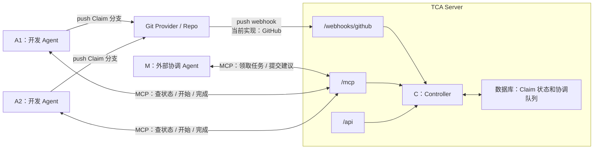
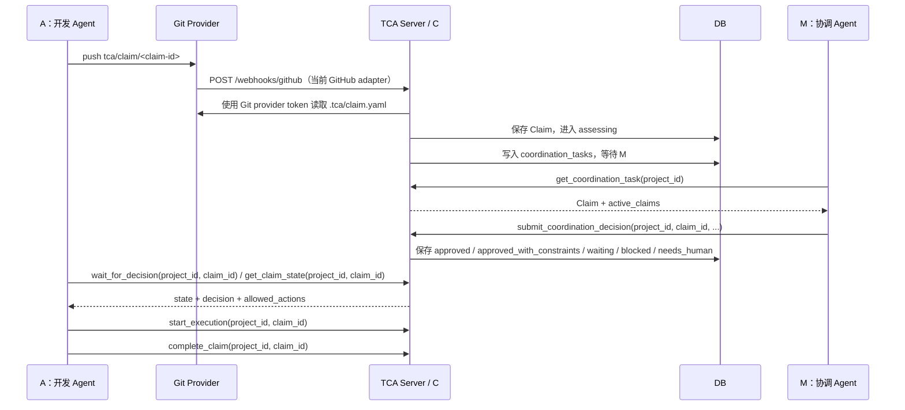
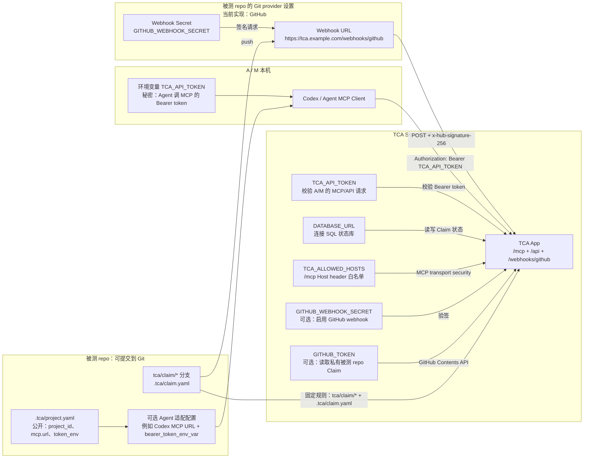

# TCA 指南：流程、配置与部署边界

TCA 是一个 Git-first 的多 Agent 协作控制服务。它的目标不是替代 Git 或 PR，而是在多个 Agent 进入同一个 repo 修改代码之前，先把意图、范围、冲突、依赖和放行条件变成共享状态。

本仓库是 TCA Server 源码仓库，不是被测 repo。当前不使用 TCA 自举开发 TCA 本体，所以 TCA 本体根目录不保留 `.tca/` 或 `.codex/` 活配置。被测 repo 接入模板放在 `templates/test-repo/`。

## 1. TCA 要解决什么问题

多个 Agent 并行改同一个 repo 时，单靠 Prompt 和 PR 很容易出现这些问题：

- 意图不可见：别人只看到最终 diff，不知道某个 Agent 准备做什么、边界在哪里。
- 语义冲突发现太晚：没有文本冲突，也可能同时改了同一个接口、数据模型或产品行为。
- 重复劳动：多个 Agent 可能在不知道彼此存在的情况下解决同一个问题。
- 范围变形：小修复可能变成公共接口修改或大范围重构，但团队仍按最初的小任务理解它。
- 依赖和阻塞不清楚：谁在等谁、什么时候应该继续或停止，没有统一记录。
- 流程无法只靠 Prompt 保证：关键状态需要确定性程序控制，而不是靠 Agent 记得遵守约定。

TCA 补的是“代码进入共享范围之前和执行过程中的协调”。

## 2. 核心模型

C 是唯一权威状态源。A 和 M 都不直接改数据库，也不互相绕过 C 指挥。



角色：

| 角色 | 职责 |
|---|---|
| P / 人 | 提出目标，处理机器无法裁决的业务决定 |
| A / 开发 Agent | 提交 Claim，获批后执行代码修改 |
| M / 协调 Agent | 判断 Claim 之间的语义冲突、依赖和风险，向 C 提交建议 |
| C / Controller | 维护状态机、校验状态转换、保存 Claim 状态和协调队列 |

当前实现里，M 不打包在 TCA Server 内。M 是外部 Agent，和 A 一样通过 MCP 调 C。

## 3. 一次 Claim 怎么走



文本版流程：

1. A 在被测 repo 创建 `tca/claim/<claim-id>` 分支。
2. A 在该分支提交 `.tca/claim.yaml`。
3. A push Claim 分支到 Git provider。
4. Git provider webhook 通知 TCA Server。
5. C 校验 webhook 签名，读取远端 repo 上的 `.tca/claim.yaml`，写入数据库。
6. C 进入 `assessing`，并把任务放入 M 的协调队列。
7. M 通过 MCP 领取任务，提交 `approved`、`approved_with_constraints`、`waiting`、`blocked` 或 `needs_human`。
8. C 校验 M 的建议并更新状态。
9. A 通过 MCP 读取状态；只有 `allowed_actions` 包含 `start_execution` 才开始修改共享代码。
10. A 开始前调用 `start_execution`，完成后调用 `complete_claim`。

当前 MCP tools 是：

| Tool | 使用方 | 作用 |
|---|---|---|
| `get_claim_state(project_id, claim_id)` | A | 查询权威状态、决策和允许动作 |
| `wait_for_decision(project_id, claim_id)` | A | 等待 Claim 离开 `received` / `assessing` |
| `start_execution(project_id, claim_id)` | A | 把已获批 Claim 转成 `executing` |
| `complete_claim(project_id, claim_id)` | A | 把执行中的 Claim 转成 `completed` |
| `get_coordination_task(project_id)` | M | 领取最早的待协调 Claim；`project_id` 可为空，表示所有项目 |
| `wait_for_coordination_task(project_id)` | M | 等待待协调 Claim 出现，超时返回 `null` |
| `submit_coordination_decision(project_id, claim_id, ...)` | M | 提交协调建议，由 C 校验并落库 |

Claim 的运行时身份是 `(project_id, claim_id)`。不同项目可以使用相同 `claim_id`，但 A/M 调用 Claim 相关 MCP tool 时必须带 `project_id`。

HTTP 查询 Claim 状态时同样要带项目：

```text
GET /api/claims/<claim_id>?project_id=<owner/repo>
```

当前通知模式是 long-polling，不是 TCA 主动唤醒 A/M：

```text
A 提交 Claim 后调用 wait_for_decision
M 空闲时调用 wait_for_coordination_task
C 只在这些请求里返回最新状态或任务
```

也就是说，A/M 都要主动连接 TCA。当前没有 callback、队列订阅、Codex task 唤醒或 server-initiated MCP notification。

## 4. 配置分层

配置容易乱，是因为有三种东西都像“配置”，但职责不同。

| 层 | 放在哪里 | 是否提交 | 作用 |
|---|---|---|---|
| Server 运行配置 | Vercel / 本机环境变量 | 不提交真实值 | 让 TCA Server 能启动、连数据库、校验请求 |
| 被测 repo 协议配置 | 被测 repo 的 `.tca/` | 提交 | 告诉 Agent 这个项目怎么使用 TCA |
| Agent 适配配置 | Codex / Claude / Cursor 等客户端配置 | 通常本机生成 | 让具体 Agent 客户端知道怎么连 MCP |

本仓库只保存第一层的模板 `.env.example`，以及第二层的接入模板 `templates/test-repo/`。本仓库根目录不保存 `.tca/project.yaml` 或 `.codex/config.toml`。

## 5. Key 和环境变量在哪里起作用

这张图回答：每个 key 放在哪里、谁用它、在哪一步起作用。



变量职责：

| 名称 | 放在哪里 | 作用 | 是否 secret |
|---|---|---|---|
| `TCA_API_TOKEN` | Server env + A/M 本机环境 | A/M 调 `/mcp`、`/api` 的 Bearer token；Server 用它校验 | 是 |
| `DATABASE_URL` | Server env | 线上状态库连接串；未设置时本地使用 SQLite | 是 |
| `TCA_ALLOWED_HOSTS` | Server env | `/mcp` 的 Host header 白名单，填 TCA Server 域名，不带 `https://` | 否 |
| `GITHUB_WEBHOOK_SECRET` | Server env + 被测 repo GitHub webhook 设置 | 启用 GitHub adapter 时，GitHub 用它签名，TCA 用它验签 | 是 |
| `GITHUB_TOKEN` | Server env | 启用 GitHub adapter 时，TCA 用它从 GitHub 读取 `.tca/claim.yaml` | 是 |

三把容易混的钥匙：

| 名称 | 谁拿着 | 用在哪条链路 |
|---|---|---|
| `TCA_API_TOKEN` | Server env + A/M 本机 | A/M -> TCA `/mcp` 和 `/api` |
| `GITHUB_WEBHOOK_SECRET` | Server env + 被测 repo GitHub webhook 设置 | 被测 repo GitHub -> TCA `/webhooks/github` |
| `GITHUB_TOKEN` | Server env | TCA -> 被测 repo GitHub API |

这三者不能互换。`GITHUB_TOKEN` 也不是 Vercel 部署源码用的 token。

## 6. GitHub、Vercel 和 Webhook 怎么分清

`fringsoo/tca` 是 TCA Server 源码 repo。它和 Vercel 的关系是：

```text
fringsoo/tca push -> Vercel Git integration -> 部署 TCA Server
```

这条链路不需要在 `fringsoo/tca` 自己的 GitHub Webhooks 里配置 `/webhooks/github`。

`/webhooks/github` 是给被测 repo 用的：

```text
被测 repo push tca/claim/* -> GitHub webhook -> TCA Server /webhooks/github
```

所以当前整理 TCA Server 本体时，Vercel 应该保留，GitHub webhook 可以不配。等之后接入独立被测 repo，再给那个被测 repo 配 webhook。

Vercel 最小环境变量：

```bash
TCA_API_TOKEN=replace-with-random-token
DATABASE_URL=replace-with-postgres-url
TCA_ALLOWED_HOSTS=replace-with-tca-server-host
```

接入被测 repo 的 GitHub webhook 时，再按需要增加：

```bash
GITHUB_WEBHOOK_SECRET=replace-with-webhook-secret
GITHUB_TOKEN=replace-with-github-token
```

Claim 入口当前直接规定，不再暴露成环境变量：

```text
Claim 分支：tca/claim/<claim-id>
Claim 文件：.tca/claim.yaml
GitHub API：https://api.github.com
```

`/health` 不需要 token。`/mcp` 和 `/api/*` 需要：

```text
Authorization: Bearer <TCA_API_TOKEN>
```

## 7. 被测 repo 模板

被测 repo 需要提交公开协议文件。本仓库只提供模板，不在 TCA 本体根目录启用它们。

```text
templates/test-repo/AGENTS.md
templates/test-repo/.tca/protocol.md
templates/test-repo/.tca/project.yaml
templates/test-repo/.tca/claim.example.yaml
```

复制到被测 repo 后，替换 `.tca/project.yaml` 里的 `project_id`、`mcp.url` 等占位值。真实 token 仍然放在 Server 环境变量或成员本机环境变量里，不写进 Git。

## 8. 当前文件地图

根目录：

| 文件 | 作用 |
|---|---|
| `README.md` | 项目入口，说明 TCA 是什么、怎么本地开发、主文档在哪 |
| `AGENTS.md` | 本仓库的 Agent 工作规则 |
| `.env.example` | Vercel / 部署环境变量模板，不含真实 secret |
| `.gitignore` | 忽略虚拟环境、数据库、缓存和 `.env` |
| `app.py` | ASGI 托管入口 |
| `vercel.json` | Vercel 函数配置 |
| `pyproject.toml` | Python 包、依赖和测试配置 |
| `uv.lock` | 依赖锁文件 |
| `templates/test-repo/` | 被测 repo 接入模板 |

代码：

| 文件 | 作用 |
|---|---|
| `src/tca/app.py` | Starlette HTTP 应用，挂载 `/health`、`/api`、`/mcp`、`/webhooks/github` |
| `src/tca/controller.py` | Claim 状态机 |
| `src/tca/domain.py` | Claim、Decision、状态枚举和 allowed_actions |
| `src/tca/rules.py` | 基础规则检查 |
| `src/tca/store_protocol.py` | Store 接口协议 |
| `src/tca/store.py` | SQLite store 和 store 构造入口 |
| `src/tca/postgres_store.py` | Postgres store |
| `src/tca/github.py` | GitHub webhook 和 Claim 文件读取 |
| `src/tca/mcp_server.py` | MCP tools |

测试：

| 文件 | 作用 |
|---|---|
| `tests/test_controller.py` | 状态机测试 |
| `tests/test_github.py` | GitHub adapter 测试 |
| `tests/test_app.py` | HTTP 鉴权测试 |

## 9. 当前没有的东西

这些内容当前不写进主流程，因为代码里没有完整实现，或者已经按“简洁原则”移除：

- 没有 TCA 自举配置：根目录不放 `.tca/`、`.codex/`、MCP 本机活配置。
- 没有 `heartbeat`、`update_progress`、`abandon_claim` MCP tool。
- 没有 `.tca/agreements/` 模板目录。
- 没有自定义 Claim 分支前缀或 Claim 文件路径；V1 固定为 `tca/claim/*` 和 `.tca/claim.yaml`。
- 没有 GitHub status check / CI 门禁。
- 没有 TCA 主动唤醒 A/M；当前使用 `wait_for_decision` 和 `wait_for_coordination_task` 做 long-polling。
- 没有内置 M Runner；M 是外部 Agent，通过 MCP 领取协调任务。
- 没有多用户 token、项目级权限、审计后台。
- 没有从 `.tca/project.yaml` 自动生成 Codex / Claude / Cursor 配置的接入命令。

如果后续实现这些能力，再把对应配置和流程写回文档。
