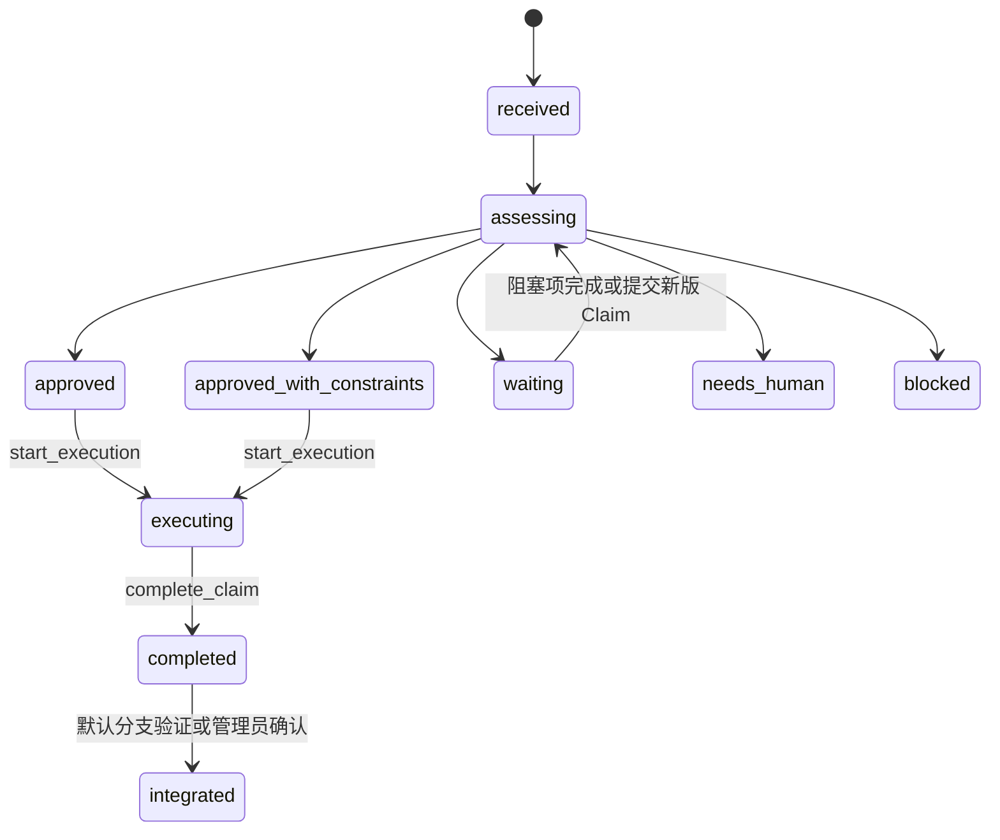

# TCA 使用说明

这个 repo 已接入 Team Code Agent（TCA）。本文件随项目提交，让新成员 clone
以后能理解配置、日常流程和 Claim 状态；它放在 `.tca/`，不会覆盖项目原本的
`README.md`。

## 模板包含什么

```text
.tca/project.yaml        项目标识和 TCA MCP 地址
.tca/protocol.md         A/M/C 协作协议
.tca/claim.example.yaml  Claim 示例
.tca/m-agent.md          M 工作区指令
.tca/README.md           本说明
AGENTS.md                开发 Agent 自动读取的入口规则
.env.example             A/M 工作区本地身份模板
```

不要提交 `.env` 或真实 token。

## 1. 项目发起者：一次性接入

项目发起者把本模板复制到被测 repo，修改 `.tca/project.yaml`：

```yaml
version: 1
project_id: owner/repo

mcp:
  url: https://tca.example.com/mcp
  token_env: TCA_API_TOKEN
```

然后把模板文件提交到被测 repo 的默认分支。以后所有成员 clone repo 时都会得到
项目标识、MCP 地址、协议和 Agent 规则，不需要各自重新填写。

在被测 GitHub repo 里添加一次 webhook：

- Payload URL：`https://<tca-server-host>/webhooks/github`
- Content type：`application/json`
- Secret：和 TCA Server 的 `GITHUB_WEBHOOK_SECRET` 一致
- Events：`push`

这个 webhook 属于项目，不属于成员。它既让 TCA 发现
`tca/claim/<agent-id>/<claim-id>` 分支，也在默认分支 push 后自动确认已集成的
Claim；只配置一次。

项目发起者还要：

1. 从 TCA Server 管理者处取得 MCP URL、共享 `TCA_API_TOKEN` 和 webhook
   secret。
2. 通过安全渠道把共享 `TCA_API_TOKEN` 发给获准加入项目的成员，不写进 repo
   或聊天 prompt。
3. 安排一个 M 工作区持续领取本项目的协调任务。

如果团队自己部署 TCA Server，服务部署和 token 生成也只做一次；使用已有 TCA
Server 时无需重复部署。

当前 TCA 使用 Server 级共享 token 和 webhook secret。一个 Server 虽能用
`project_id` 处理多个项目，但只适合同一信任范围，不提供互不信任团队之间的
权限隔离。

## 2. 团队成员：每台机器一次

成员 clone repo 后：

1. 配置自己的 GitHub 凭证，确保 Agent 可以创建并 push Claim 分支和工作分支。
2. 从项目发起者处领取现成的 `TCA_API_TOKEN`。不要自行生成，因为当前团队内
   所有 A/M 使用同一个服务 token。
3. 把 token 保存到 MCP 客户端的机器级环境或 secret store，并按
   `.tca/project.yaml` 中的 URL 配置原生 MCP 连接。

`token_env: TCA_API_TOKEN` 只是告诉客户端读取哪个环境变量，不包含 token，
也不会自动生成 token。一台机器配置好后，在这台机器上参加同一 TCA 服务下的
项目通常不用重复配置。

真实用户不需要安装或 checkout TCA Server 源码仓库。Agent 客户端必须能看到
TCA MCP tools；如果看不到，先修复机器级 MCP 配置，不要开始修改共享代码。

## 3. A 工作区：每个并行 Agent 一个身份

每个开发 Agent 都使用一份普通 clone 或 worktree。

从 `.env.example` 创建 `.env`：

```bash
cp .env.example .env
```

只填入这个工作区的稳定身份：

```text
TCA_AGENT_ID=agent-a1
```

并行 Agent 使用不同值，例如 `agent-a1`、`agent-a2`。成员给 A 的 prompt 仍然
只是普通产品需求，不需要写“你扮演 A”或逐步指挥 TCA。A 从仓库里的
`AGENTS.md` 得知协议，并自动完成 Claim 流程。

## 4. M 工作区

M 是单独的协调 Agent，不复用 A 工作区。如果 M 要做语义判断，它应自己 clone
一份被测 repo，并直接在这个 repo 根目录运行：

```bash
git clone https://github.com/owner/repo.git repo-for-m
cd repo-for-m
git remote set-url --push origin DISABLED
cp .env.example .env
```

把 M checkout 的 `.env` 设置为：

```text
TCA_AGENT_ID=agent-m
```

共享 `AGENTS.md` 会读取这个保留身份并加载 `.tca/m-agent.md`，因此用户不需要
再粘贴“你是 M”或协调步骤。用户只需启动 task；当前 long-poll 方案不会主动
启动或复活已经退出的 Agent。

M 从当前 repo 的 `.tca/project.yaml` 读取 `project_id` 和 MCP URL，并从自己的
MCP 客户端读取同一个团队 `TCA_API_TOKEN`。它持续调用：

```text
wait_for_coordination_task(project_id)
submit_coordination_decision(...)
```

如果 M 只有 Claim 元数据，它只能做路径级和依赖级判断。如果 M 要做语义判断，
就只读查看自己这份 repo checkout，不提交、不 push。

## 5. 日常使用

完成一次性接入后，人只向 A 提正常产品需求。A 对每个需求执行：

1. `git fetch origin`，记录远端默认分支的完整 SHA 作为 `base_commit`。
2. 从该提交创建 `tca/claim/<agent-id>/<claim-id>`，并提交
   `.tca/claim.yaml`。
3. Push Claim 分支。
4. 调用 `wait_for_decision(project_id, claim_id)`。
5. 只有 `allowed_actions` 包含 `start_execution` 时才开始。
6. 从 `base_commit` 创建并 push `feature/<agent-id>/<claim-id>`；先满足
   Decision 约束，再修改代码。
7. 工作分支 push 后，调用 `complete_claim(project_id, claim_id)`。

GitHub webhook 会拒绝基于旧默认分支提交的新 Claim，也会拒绝 `base_commit`
不在 Claim 分支历史中的 Claim。Claim 后续递增 `version` 修改范围时，
`author`、`base_commit` 和 `work_branch` 保持不变。

TCA 的 `completed` 不等于 merge 到默认分支。completed Claim 会继续参与协调，
防止后续 Agent 忽略尚未进入基线的工作。PR、CI、merge 和最终产品取舍仍走团队
自己的集成流程；合并者只需正常 merge 和 push。GitHub 默认分支 webhook 会让
TCA 验证工作分支是否已进入提交历史，验证成功后转为 `integrated`。

普通 merge commit 和 fast-forward 可以自动确认。关闭 webhook、使用其它 Git
provider，或 squash/rebase 改写提交历史时，由管理员核验后使用
`integrate_claim` 兜底；普通 A 不需要处理。

## 6. Claim 状态机



| 状态 | 代表什么 | A 或用户应该做什么 |
|---|---|---|
| `received` | C 刚收到 Claim | 短暂中间态，继续等 |
| `assessing` | 等 M 判断语义、依赖和风险 | A 调 `wait_for_decision`，不要改共享代码 |
| `waiting` | 仍 active 的 Claim 阻塞了当前工作 | 继续等；默认不需要改 Claim |
| `approved` | 可以按原计划开始 | A 调 `start_execution` 后执行 |
| `approved_with_constraints` | 可以开始，但必须满足 Decision 约束 | A 先读约束，再调 `start_execution` |
| `needs_human` | M 无法安全决定 | 人做取舍，再让 A 提交递增 version 的 Claim |
| `blocked` | 当前方案不应继续 | 停止；修改方案并提交新版 Claim，或放弃任务 |
| `executing` | A 已获批，正在修改 | 完成、测试、push work branch，再调 `complete_claim` |
| `completed` | work branch 已完成，但还没进入默认分支 | 等集成；不要当成任务已上线 |
| `integrated` | Git 已证明工作进入默认分支 | Claim 生命周期结束 |

`allowed_actions` 是 C 给出的硬门禁，不是建议。A 只执行其中列出的下一步；没有
`start_execution` 就不能开始修改共享代码。

`waiting` 通常表示路径或依赖与仍 active 的 Claim 重叠。A 不必马上重写 Claim，
而是继续 `wait_for_decision`。阻塞项 completed 后，C 会自动把当前 Claim 放回
`assessing`；M 此时还能看到前一项的 completed work branch，并决定是否要求
当前 A 先纳入它。只有 A 主动缩小范围、改变依赖或改目标时，才提交
`version: 2`、`version: 3` 等修订。

`wait_for_coordination_task` 只给 M 使用：它返回一个 assessing Claim、同项目
active Claims 和 completed-but-unintegrated Claims。A 查询自己的状态使用
`wait_for_decision`，两者不能混用。

最后记住两个边界：M 只做判断，不直接把 Claim 改成 executing/completed，也不
写业务代码；`completed` 只说明分支准备好了，`integrated` 才说明 Git 集成闭环。
